# Grok Bot Twin

**Try Hermes without leaving Grok. Move over when your twin is ready.**

For people who built bots in the Grok desktop app and want to try Hermes without giving them up. Grok Bot
Twin gives each Grok bot a **twin**: a second home for the bot in Hermes that keeps its name and description
in step with Grok. You paste its instructions once. Nothing changes in Grok. A **Twins** page in Hermes
Desktop shows each twin in one line, asks you to choose when something changed in both places, keeps earlier
versions for undo, and walks you through the day you move its routines.

## In Hermes Desktop

1. Open **Capabilities → Plugins**, find **Grok Bot Twin**, install it and turn it on (if it shows two
   switches, turn on both).
2. Open **Twins** in the sidebar.
3. Press **Connect my Grok bots**, or **See a sample first**. On a computer without the Grok app, press
   **Link this computer** instead (see "Your twins on your other computers" below).

**See a sample first** needs no Grok account: it shows one sample twin with invented data. **See the twin**
puts the bot as Grok has it next to its twin in Hermes; press **Change the bot in Grok** and watch the twin
follow. Under **What can go wrong?** three more buttons (change it in both places, paste a fake password,
change a skill in Hermes) show what the page does then. Nothing of yours is touched, and **End sample**
removes it.

**Connect my Grok bots** opens two steps (once, about a minute, no terminal) that tick by themselves:

| Step | What you do |
|---|---|
| 1. The Grok desktop app | Nothing, if the Grok desktop app is on this computer and you are signed in. If it is not, the row says so: install the Grok desktop app, sign in, and the row ticks itself. Twins cannot reach bots that exist only in a browser or on a phone yet; the sample still works. |
| 2. Get botport | Press **Download botport** (your browser fetches the file for your computer). Hermes then finds the download itself ("Found botport in Downloads. **Use it**"), or you press **Choose the file…** and pick it. botport is a small, free, open-source app by the same author that reads your bot list from Grok. Hermes verifies on the spot that the file is the real botport release before it is ever run, and keeps its own copy, so you can delete the download. If the file is wrong, the row says so and **Download botport** is the button to press. |

Then choose your bots, read the short summary of what copies now and what comes later with the page's help,
and press **Twin this bot**. Nothing changes in Grok.

Then one sheet says what is left, for every new twin at once: "3 twins made. Each needs its instructions and
a model." Each twin has a box, all ticked. Two ways on:

- **Do all ticked now.** One model choice for every ticked twin (it starts on the model your other Hermes
  chats use; each twin's model can be changed later in Hermes). Then press **Copy the request** once and
  paste it into the chat of each ticked bot in the Grok app. Each bot answers with its setup export, a small
  file; save it to your Downloads folder, or drop several at once on the sheet. The page watches Downloads
  while the sheet is open, matches each file to its twin by the bot's name (or its id, when the file has
  one), and imports it at once: the instructions, the routines (switched off), and the connector names. A
  line per twin says how far it is: "Acme Helper: instructions in ✓", "2 routines added, switched off",
  "waiting for its file…". The lists of memories and facts about you in those files are left out; Hermes
  never stores them. **Paste it yourself instead** is still there for any twin. If skill sync is set up, the
  sheet offers it as the way to keep their skills the same.
- **One at a time.** The twin's own sheet: paste its instructions, choose its model.

Optional, and visible on the same sheet: **Let Hermes do the Grok part**. Hermes' own computer-use tool can
open each ticked bot's chat in the Grok app, paste the request and save the answer to Downloads. The sheet
first checks that computer use is there (if not, it says exactly what to switch on), then shows what Hermes
will do, that every click asks you first, and that pictures of the Grok window go to the chat's model
provider. Nothing starts until you tick "I will approve each step myself" and press **Start in a new Hermes
chat**. This path has not been run against the real Grok app; see [docs/SETUP-ORIGINS.md](docs/SETUP-ORIGINS.md).

The same in the terminal: `hermes twin finish --all --model MODEL` sets the model and prints the request;
`hermes twin import-exports ~/Downloads` imports every answer file it finds there, after one question.

If a line of the instructions looks like a password or key, it is left out and its line number is shown;
when you paste by hand, nothing is saved until you save without it or say it is not a password. A new twin
uses the model of your other Hermes chats when there is one, so often only the instructions are left.

After that the row says "Follows Grok · ready" and **Open in Hermes** starts a chat with the twin.

Honest scope: name and description changes reach the twin in seconds (while Hermes is running, the plugin is
woken the moment the Grok app saves its bot list; see "How fast is it?" below); instructions are something you
bring over yourself, by pasting them or with Import setup export; skills can travel through optional skill sync
(a small sync bot in your own Grok account); routines and connections come over with Import setup export
(routines switched off, connections as names) or you set them up yourself, with a list to work through. A bot's Grok memory and
its Grok model setting are not copied. The table under "What copies over, honestly" has every item and the
reason for each.

Unofficial; not affiliated with xAI. Your real bots need [botport](https://github.com/hudsonwa/botport) (MIT),
a separate small app that you get yourself; the plugin never downloads it. The sample does not need it.

| First visit | Connect, once |
|---|---|
| 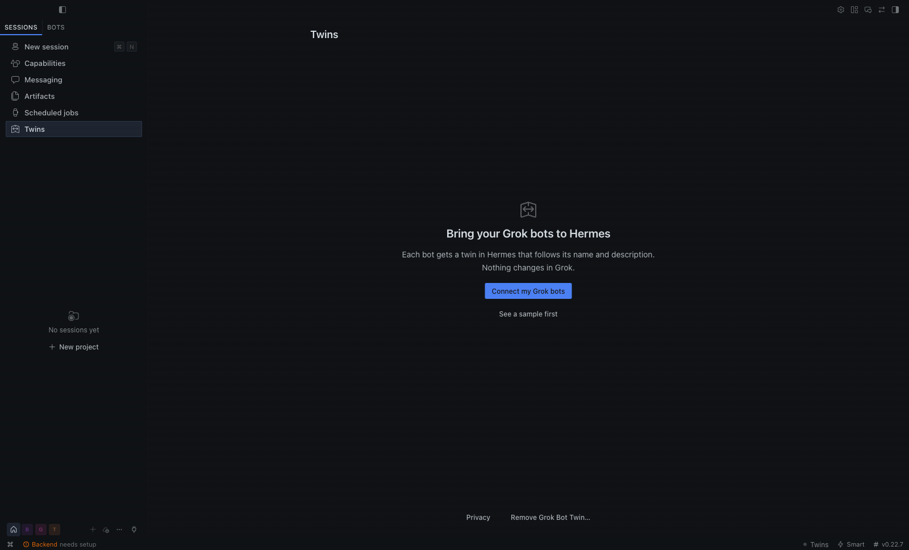 | 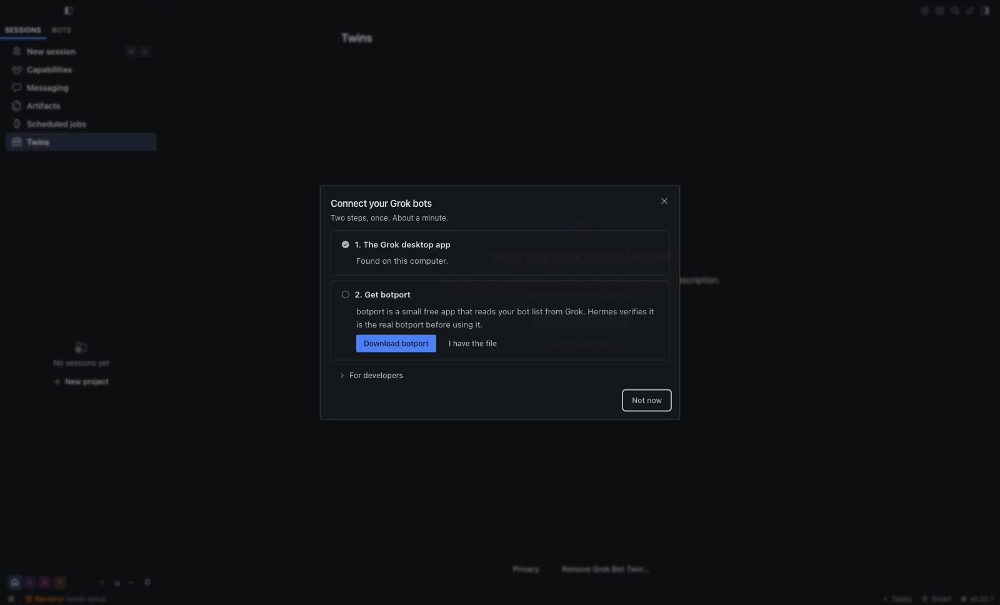 |
| Two short sentences, one button, and a sample to look at first. | Two rows that tick themselves. Nothing runs until the download is verified. |
| 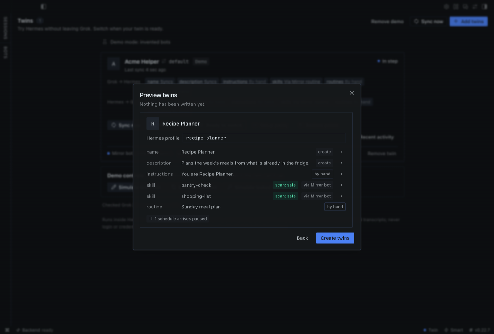 | 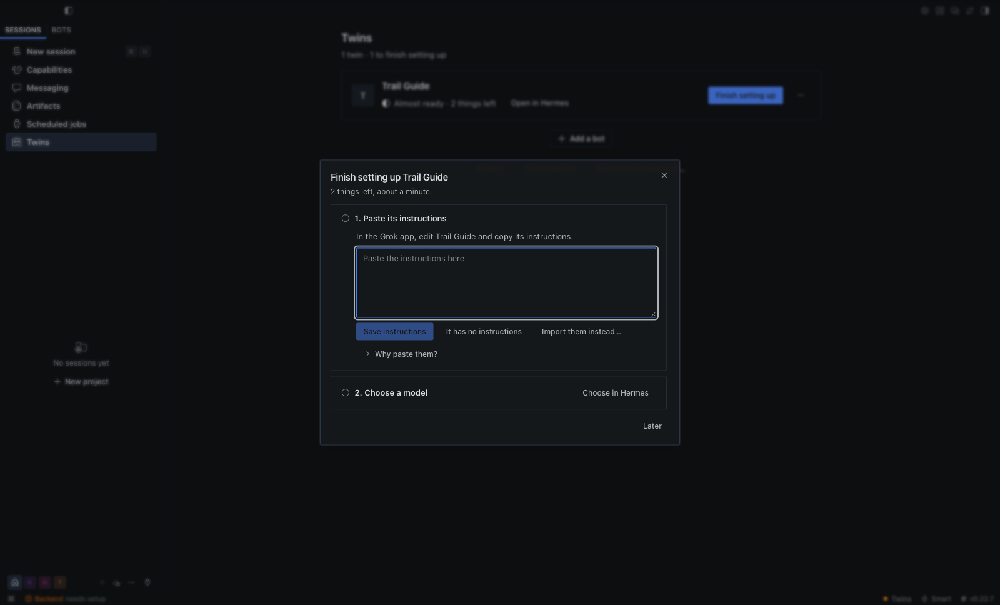 |
| Before anything is written: what copies now, and what comes later. | One twin at a time: paste its instructions, choose its model. |
| 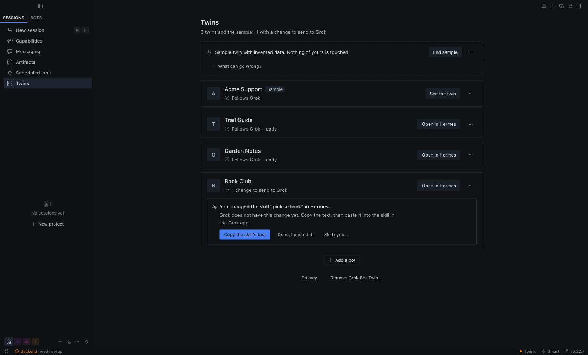 | 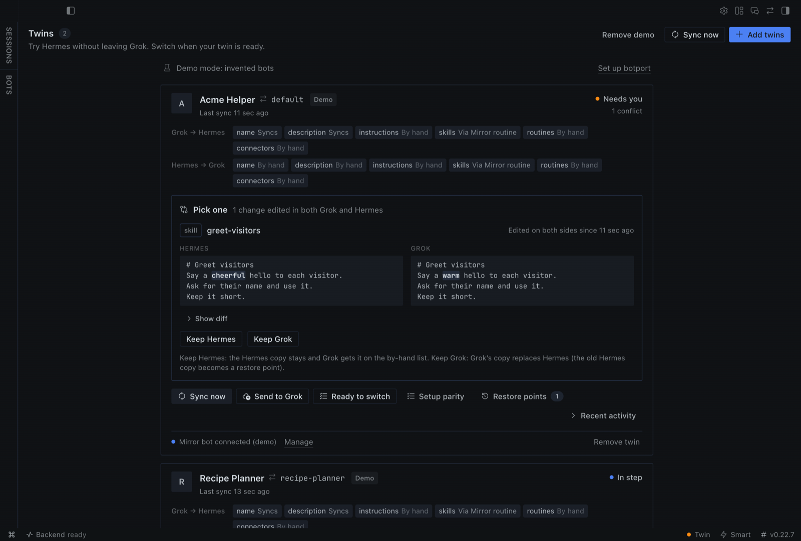 |
| One line per twin: how it is doing, and one button only when something needs you. | Changed in both places? See both versions and choose one; each choice says what happens. |
| 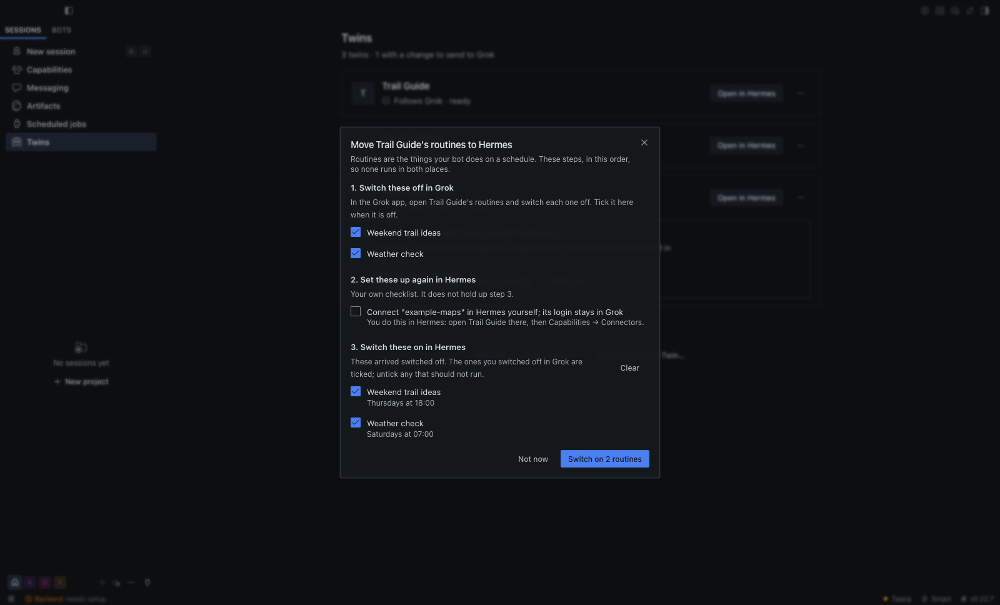 | 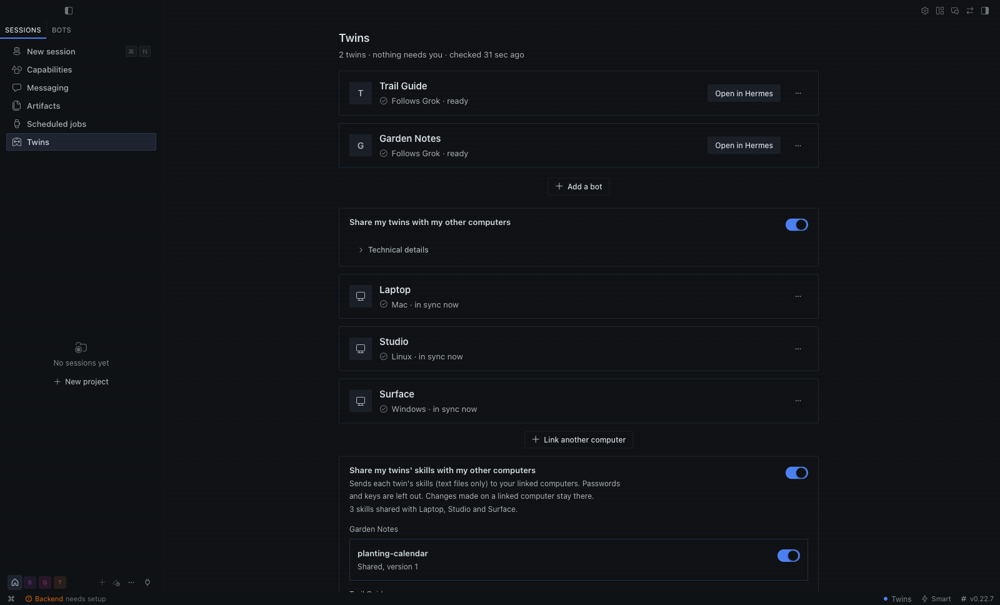 |
| A twin's routines: switch each one off in Grok, then on in Hermes, so nothing runs twice. | Sharing switched on: your other computers, each in sync, and the skills they share. |
| 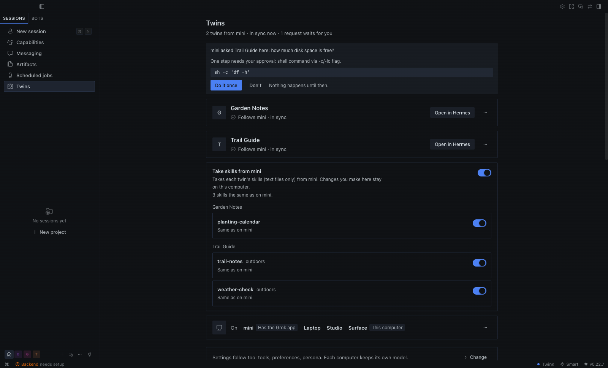 | 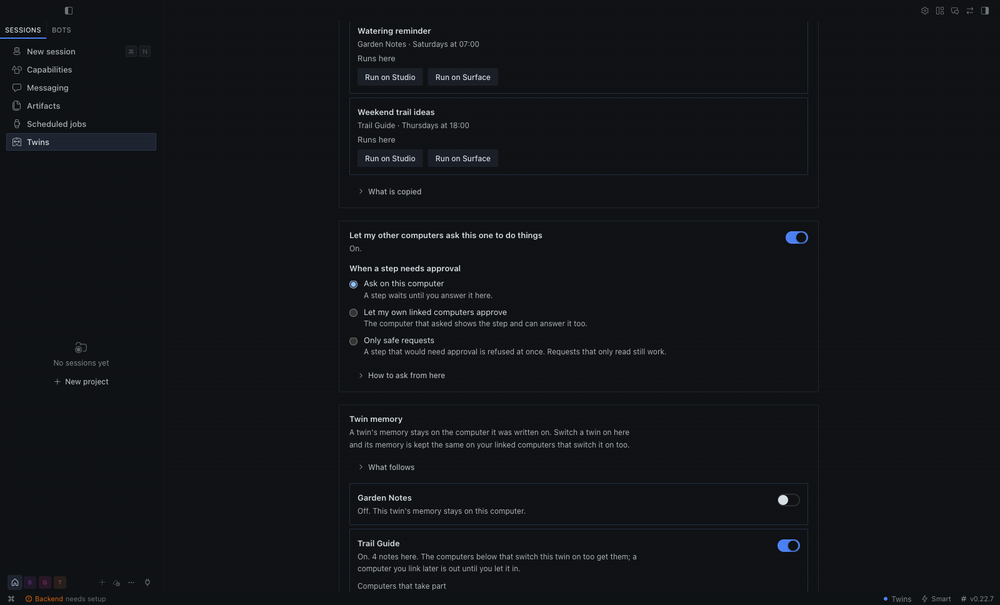 |
| On a linked computer: a request from the Mac shows the step first and waits for **Do it once** or **Don't**. | A step that needs approval waits on this computer, is also shown on the computer that asked, or is refused at once. |
| 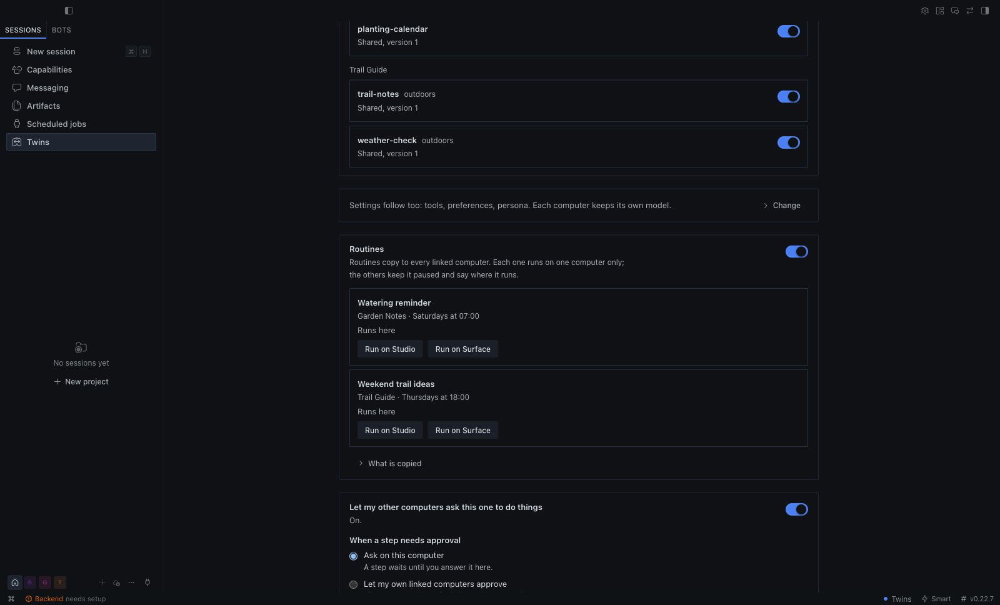 | 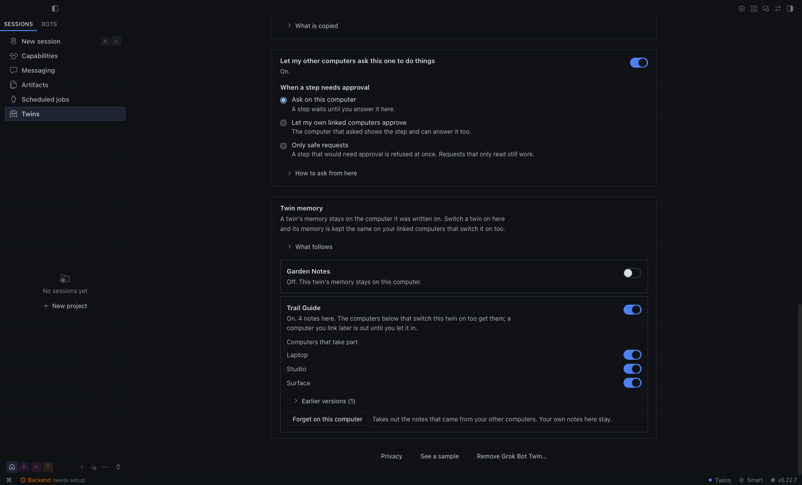 |
| Settings, skills and routines follow to your linked computers; each routine runs on one computer only. | A twin's memory, kept the same on the linked computers you choose, with earlier versions and **Forget on this computer**. |
| 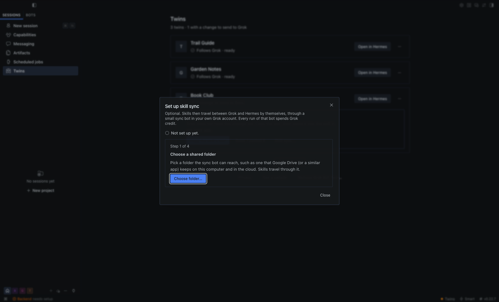 | 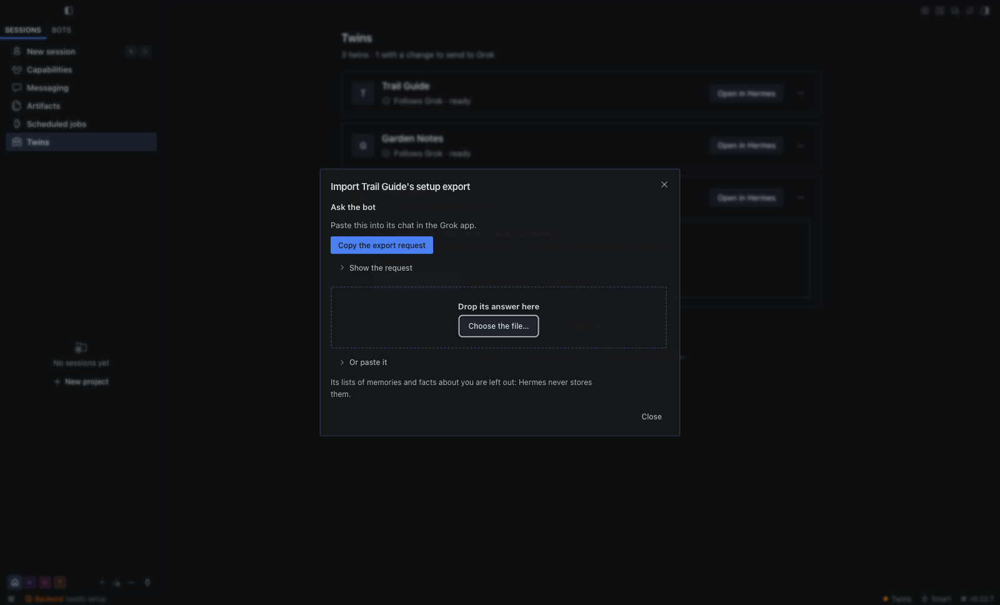 |
| Optional skill sync in four steps; it says first that its sync bot spends Grok credit. | Ask the bot in Grok for its setup export, then drop the answer here. |
| 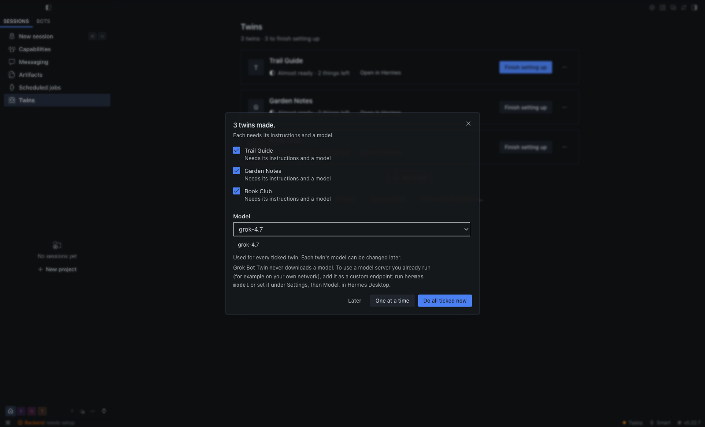 | |
| Several new twins at once: one model for all, and each one's setup export taken in as it arrives. | |

The pictures are taken in a throwaway Hermes home with invented bots only.

## Start from wherever you are

However you start, the same command does the work: `hermes twin setup`. It can be run again at any time, and a
step that is done is skipped.

| You are | Do this |
|---|---|
| In Hermes Desktop | Open **Twins** and press **Connect my Grok bots** (above). |
| In a Hermes chat | Say "set up Grok Bot Twin". The plugin ships a skill (`grok-bot-twin:set-up-grok-bot-twin`) that walks you through it in the chat: it shows the plan, waits for your yes, links your other computers and offers skill sync. |
| In a coding agent (Claude Code, Cursor, Codex or any other) | Point it at this repository. [AGENTS.md](AGENTS.md) gives it the exact steps, what it must never do, and how to check its work. |
| In a terminal | `hermes twin setup --check`, then see "One setup command" below. |

Whoever runs it, four things stay yours: downloading botport with your browser, bringing each twin's
instructions over, choosing a model for a twin that has none, and every sign-in. No agent is asked to type a password, a key or a twin's pass, and none makes
changes in the Grok app.

Two more ways in are designed and not built: Hermes doing the clicks in the Grok app for you while you watch
and approve each one, and a Grok bot setting itself up as the sync bot. Neither has been run on the real Grok
app; [docs/SETUP-ORIGINS.md](docs/SETUP-ORIGINS.md) has both designs and the test plan.

## Everyday use

Each twin is one row: the bot's name, one sentence ("Follows Grok · ready", "Almost ready · 2 things left",
"Updating…", "3 things need you", "Not following Grok right now", "Not in Grok any more", "Can't check right
now") and at most one button. When anything is waiting for you, exactly one button on the whole page is the
highlighted one, and the line under the title counts every kind of open thing ("3 twins · 1 needs your
attention · 3 to finish setting up"). Everything else is in the row's **…** menu: Check now, Details…,
Earlier versions…, Import setup export…, Skill sync…, Move routines to Hermes… (when the bot has routines) and
Stop twinning….

**Open in Hermes** starts a chat with the twin. Twins is still there when you come back: if Hermes Desktop is
pointed at the twin's own Hermes bot, the page goes back to your twins by itself.

When something needs you, the row shows the first matter as a box that says what happened and what to do, and
any others as one-line headers you can open:

- **Changed in both places.** You see both versions with the changed words marked and choose one. Keep the
  Grok version: it replaces the one in Hermes, and you can undo that under Earlier versions. Keep the Hermes
  version: Grok still has its own, and you can send this one to Grok afterwards.
- **A skill changed in Hermes.** With skill sync on: send it to Grok (a skill Grok does not have yet is
  installed there; for one it already has, paste the change into Grok yourself), or keep it in Hermes only. Without:
  **Copy the skill's text**, paste it into the skill in the Grok app, then **Done, I pasted it**.
- **A password or key was not copied.** Something in the bot's text looks like one (known key formats, private
  key blocks, long random-looking words), so that item was not copied at all. You see which item and where,
  never the value. Remove it in the Grok app; Hermes notices by itself. This check can miss things: keep
  passwords and keys out of a bot's text.
- **Can't check right now.** The reason and the one thing to do, in plain words, and **Try again**.
- **Not in Grok any more.** The twin stays as an ordinary Hermes bot. **OK, stop following**, or wait for it
  to come back.

When no twin can follow Grok, one banner says why, once, and the rows say "Not following Grok right now"; you
can still open every twin in Hermes. botport was updated: **Verify botport** fixes it in one press. botport
is gone: **Get botport again…**. The Grok desktop app is gone: nothing to press; the banner clears by itself
when Grok is back.

No pop-up repeats what the page is already showing. Elsewhere in Hermes a notice appears once, leaves by
itself, and its button opens Twins.

**Details…** is one sheet with three sections:

- **What copies over**: what copies by itself, what copies with skill sync on, what you bring over yourself,
  and what matches Grok right now ("Name, description and 2 skills match Grok."), with the reason and the
  button for each part that differs. **The whole table** opens the table from "What copies over, honestly"
  below: every item, how it gets across, and why Grok memory and the Grok model setting do not copy.
- **Earlier versions**: whenever a check (or your choice of the Grok version, or a paste) replaces something
  in the twin, the version before is kept. **Show** lets you read it and **Put back** acts at once; the notice
  that follows offers **Undo**. Putting one back changes only that item in Hermes. A twin that has not changed
  yet lists none.
- **Recent activity**: what changed lately and where. Times and kinds only, never what was said.

**Move routines to Hermes** (routines are the things your bot does on a schedule): switch the routines off in
Grok and tick them. Where the twin holds switched-off copies of them (the sample does), the last step,
switching those copies on in Hermes, opens when they are ticked, with the same routines ticked already, so
nothing runs twice. A twin made from the Grok app's files holds no copies, because Grok keeps a routine's
schedule to itself: the sheet says so and lists each routine for you to make again in Hermes. Only two things
hold this up: a choice between two versions that is still open, and a twin that cannot be checked. Afterwards the row says "Follows Grok · 2
routines run in Hermes" and offers **Pause routines**, which switches them off in Hermes again; the menu item
becomes **Routines in Hermes…**.

**In chats**: in a twin's Hermes bot the model gets a short, data-only note each turn ("your Grok twin", an
internal id such as `t-1a2b3c4d5e6f7a8b` and whether it is up to date). The `twin_status` and `twin_recent`
tools use the same label and id: by default no bot, routine, skill or connection names reach the model (its
to-do list says "Turn off 2 routines in Grok when you move to Hermes (names on the Twins page)"). Turn on
"Let the model see names" to let the tools name them, reduced to plain characters; the per-turn note never
carries names. The sample twin stays out of your chats unless you name a Hermes profile for it in the
settings, and then the note says "This is a sample twin with invented data."

### Example: the agent answers from `twin_status`

An example chat about the sample twin (the reply is the model's wording; the facts and counts come from the
`twin_status` tool result, with names off):

> **You:** What do I still need to set up in Grok?
>
> **Assistant** (called `twin_status`): This is the built-in sample twin with invented data. Your Grok twin is
> up to date, with nothing changed in both places. In Grok: turn off 2 routines when you move to Hermes, so
> nothing runs twice (their names are on the Twins page), and if you change the name, description or
> instructions here in Hermes, make the same change in Grok yourself. In Hermes: turn on the 2 routines when
> you move and set up 1 connection yourself. Skills copy when skill sync is on.

### Import setup export

A Grok bot can write down its own setup, and its twin can take it in. In a twin's "…" menu choose **Import
setup export…** (the terminal has `hermes twin import`):

(For several new twins at once, the sheet after **Twin N bots** does this for all of them: see "In Hermes
Desktop" above. Each file is then imported as it arrives, without the preview below; what it does is the same.)

1. Press **Copy the export request** and paste the text into the bot's own chat in the Grok app. It asks for
   the bot's instructions, its routines and the names of its connectors, and for nothing the bot remembers
   about you. The bot answers with one file.
2. Drop that file on the sheet (or press **Choose the file…**, or paste the answer). The sheet shows what an
   import would do; nothing is changed until you press **Import**. Open **Show the text** and read it first:
   it holds the instructions and every routine's prompt whole, exactly as an import would save them.

What an import does:

- **Instructions** are saved as the twin's instructions, the same way a paste is. Every line a password or key
  touches is left out (a label on one line and its value on the next are both left out) and the sheet names
  the line numbers. Characters nobody can see are taken out. The version before is kept under Earlier
  versions. Instructions over 200 kB are not copied.
- **Routines** arrive switched off: each one with a five-field schedule becomes a Hermes routine that does not
  run. Turning them on is still **Move routines to Hermes**, after you switched the Grok ones off, so nothing
  runs twice. A routine that starts on an event, whose prompt is longer than 16 kB, or whose name or prompt
  looks like it holds a password or key, is not made; the sheet lists it for you to add yourself. A routine
  whose name is already in the twin's Hermes bot is left alone (by name; the two are not compared).
- **Connectors** become a list, "Set up on this computer", of names only. No address and no login is copied.

The file's lists of memories and of facts about you are left out: Hermes never stores them. The file itself
is not kept either: its text is read for the preview and once more for the import. What an import writes is
the three things above and four small notes of its own: the ids of the routines it made, that the
instructions came from an export, for each routine its name with a short digest (so its Hermes copy does not
ask to be sent back to Grok), and an event with counts. Skills in the file are counted and left alone (skills
travel by skill sync, or you copy them yourself). Nothing is sent to Grok. The file is the same
`grok-bot-export` document that botport's `--from-export` and Hermes' own Grok importer read, so an export you
already have works too.

What this cannot do for you: the bot wrote the file. Whatever it put into its instructions, a routine or a
connector's name is taken as that, also when it is something the bot remembers about you; Hermes can only
leave out the two lists that are named as memories. The password-and-key check is a check, not a guarantee:
it misses short passwords and addresses with a login in them. So read the text before you import. While a
routine is being added, its name and prompt are arguments of a Hermes command for a few seconds, which other
users of this computer could see. **Stop twinning** later forgets the list of connectors; the imported
instructions and the switched-off routines stay in the Hermes bot, which is yours.

## What copies over, honestly

One table says it all. The Twins page shows the same one (a twin's **…** menu, **Details…**, **The whole
table**), and so does `hermes twin copies` in a terminal. Per twin, **What syncs** in its Details (and
`hermes twin syncs TWIN`) shows each item with the way it goes, when it last synced, and what this version cannot
do yet; a row that needs the Mirror or is not in this version yet says so and cannot be switched on.
Hermes → Grok (name, description, instructions and routines made in Grok by the Mirror bot) is off for every twin
until you allow that twin (`hermes twin to-grok TWIN allow`, or the twin's **Hermes → Grok…** on the Twins page),
and nothing is sent until you look at the preview and apply exactly that preview. The Auto-Review rule it shows for
Grok names the bot by its id and covers only edits of that bot's own name, description, instructions and existing
routines, never a new routine; stopping (`hermes twin to-grok TWIN disallow`) names that exact rule for you to delete
in Grok.

<!-- what-copies:begin (written by twin/copies.py: change the table there) -->

| What | How |
|---|---|
| **From Grok to Hermes** | |
| Name and description | By itself, in seconds, while Hermes is open. |
| Instructions, routines and connections | With Import setup export: the bot writes a file about itself when you ask it in Grok. Instructions are filled in, routines arrive switched off, and connections arrive as a list of names. Logins are never copied. With skill sync set up, instructions also follow Grok's every 15 minutes by themselves, unless you switch that off. When it is unsure which to keep, you are asked. |
| Skills | With skill sync, which is optional: a sync bot in your own Grok account carries them. Without it you copy them yourself. |
| Conversations | Off until you switch full transcripts on for a twin. Then conversations from a Grok export can become Hermes chats of the twin; full transcripts are set up in the terminal. |
| Grok memory | Does not copy: memory is the most private thing a bot holds, so none is taken unless you switch on memory facts, which need skill sync. |
| Grok model setting | Does not copy: nothing Hermes reads from Grok names the bot's model, so the twin uses the model you choose in Hermes. |
| **From Hermes back to Grok** | |
| Name, description and instructions | Off for every twin until you allow it. Then, with skill sync set up, you see a preview of each change and apply it. A bot in your own Grok account makes it there, and you can undo it. Otherwise you make the same change in Grok yourself. |
| Skills | With skill sync, after you press Send to Grok: a skill Grok does not have yet is installed there. A skill Grok already has under that name is not replaced; paste the change into Grok yourself. Without skill sync you paste them all yourself. |
| Routines and connections | Routines go like the name, once you allow them for a twin. Each routine runs in one place that you choose, never in both. Connections you change in Grok yourself. |
| **Between your own computers** | |
| Name and description | By itself, in seconds, once the other computer is linked and Hermes is open on both. |
| Skills | Off until you switch it on. Then the text of each twin's skills follows the Mac with the Grok app. A skill changed on both computers asks you which one to keep. |
| Routines | Off until you switch it on. Then each twin's routines copy to every linked computer, and each routine runs on one computer that you choose, never on two. |
| Memory | Off until you switch it on for a twin. Then it travels encrypted, between your linked computers only. |
| Settings | By itself, item by item: tools, preferences and instructions follow the Mac with the Grok app. Each computer keeps its own model unless you switch that on. |
| Instructions | By itself, as one of the twin's settings. You can switch that off on each computer. |
| Chats, files and logins | Not copied. A request you send to another computer and its answer are the only chat text that travels, and only with requests switched on. |

<!-- what-copies:end -->

Why so much is yours to bring over: from the Grok desktop app's local files, botport opens only the bot list
(id, name, description) and the selected bots' transcript files, read only for routine-change events. Those
files hold no instructions, skills, schedules or connections, and botport takes nothing else out of them, so
the plugin does not pretend otherwise.

**Skill sync (optional)**: skills can travel between Grok and Hermes through a small sync bot in your own
Grok account and a shared folder that sync bot can reach (for example one that Google Drive keeps on both
sides). **Every run of the sync bot's routine spends Grok credit, also when nothing changed**: once an hour is plenty.
Hermes never touches the Grok app; the **Set up skill sync** sheet does everything else and shows one step at a
time, each with its buttons:

1. **Choose a shared folder.**
2. **Give the sync bot its instructions.** You make a new bot in Grok; **Copy instructions** has the text.
3. **Send it the set-up folder.** Hermes made one folder with all the sync bot needs: its guide, a small
   script, botport for its box with checksums, and the twin's pass as a file. You attach every file in it to
   one message (**Copy the message** has the words) and never paste what is in a file. botport for the box
   is a second download from the same release page; the sheet has the link, finds the file in your Downloads
   folder and checks it against the plugin's list of release files before it goes into the folder.
4. **Give it a routine, then check.** **Copy routine prompt** has the text; **Check** shows when the sync bot
   last ran.

| What the sheet does for you | How |
|---|---|
| A new skill you send from Hermes is installed in Grok from the first run | the script lets botport install each one, after botport checked it against the twin's pass |
| A later twin needs no chat | **Add NAME to skill sync**: Hermes puts a signed list and that twin's pass (a file) in the shared folder; the sync bot takes them on its next run |
| You can see that it works | "Skill sync last ran 12 min ago", read from one small file the script writes on every run |
| The sync bot's botport is checked | if it is not the release this computer runs, the sheet says so and offers **Send the set-up folder again…** |

Turning skill sync off asks first: skills go back to copy-yourself, the sync bot's list no longer names the
twin, and the pass is replaced, so the sync bot must be set up again to turn it back on. In the terminal:
`hermes twin skill-sync --folder DIR` prints the same steps with the files to use, and
`hermes twin skill-sync --status` says when the sync bot last ran.

## Your twins on your other computers

Your Grok bots live in the Grok app on one Mac. Hermes may run on several computers. Switch sharing on, and
every twin on that Mac also appears as a Hermes bot on your other computers (Mac, Windows, Linux) and stays in
sync by itself. There is no account, no cloud service and no "main computer" to choose.

Every computer needs Hermes with Grok Bot Twin installed and turned on (see "In Hermes Desktop" above), and
the same private network as the Mac: the same home network, or [Tailscale](https://tailscale.com) on both.
Your other computers need no Grok app and no botport. Installing it there is one line in a terminal, if you
prefer that to **Capabilities → Plugins**: `hermes plugins install grok-bot-twin --enable`.

### Mac

**The Mac with the Grok app shares** (2 steps):

1. Open **Twins** and switch on **Share my twins with my other computers**.
2. Read the **link code** it shows, like `7KQ4-M2XD-P9RA`, or press **Copy**.

A code links one computer and is good for 10 minutes; **New code** makes the next one. When a computer has
linked, the code goes away and that computer is listed under the switch, with "in sync now" next to its name.

**Another Mac links** (3 steps):

1. Open **Twins** and press **Link this computer**.
2. Type or paste the link code. Capitals, spaces and dashes do not matter.
3. Press **Link**. A pasted code links by itself.

The twins are there about a second later. The page says where they come from ("2 twins from mini · in sync now"),
and each one is an ordinary Hermes bot: **Open in Hermes** starts a chat with it.

### Windows

A Windows computer links to your Mac. It cannot share, because botport has no Windows version.

1. Install Hermes and Grok Bot Twin from an ordinary window, not one opened with "Run as administrator".
2. Open **Twins** and press **Link this computer**.
3. Type or paste the link code and press **Link**.

Nothing else is asked: no administrator rights, and no firewall question, because a linked computer only
calls out to your Mac and never waits for calls.

### Linux

1. Open **Twins** and press **Link this computer**.
2. Type or paste the link code.
3. Press **Link**.

Nothing else to install, open or allow.

### What you get, and how fast

On each linked computer: one Hermes bot per twin, called after it, with its name and description, your default
model on that computer, and a short note in its prompt file that says which computer this copy is on, which
others hold a copy and which one has the Grok app; that is how a twin knows where it is. Of the model only its
name and provider are copied: if yours is reached at an address you typed in yourself, add that address in the
new bot's settings before it can answer. A twin's instructions, tools and preferences follow to a linked
computer as its settings, item by item (see "Settings that follow a twin"; the last part of the table under
"What copies over, honestly" has the whole list). Skills are copied only if you
switch that on (see "Skills between your computers"), and routines only if you switch Routines on (see
"Routines on your other computers"). Memory is copied only for a
twin you switch it on for (see "A twin's memory on your other computers").

Measured between four computers over Tailscale: a Mac that shared, and a second Mac, an Omarchy (Linux) desktop and a
Windows 11 laptop that were linked. The twins were invented ones, changed with a test command, so the time the Grok app takes to
save a change (see "How fast is it?") comes on top:

| What | How long |
|---|---|
| Linking, the whole command | 0.5 to 1.8 s; about 5.5 s on Windows when Hermes had to start first |
| A new name or description reaches the other computers | 0.3 to 1.4 s |
| A new twin appears there | 0.6 to 2.5 s |
| A twin you stopped twinning leaves them | 0.4 to 0.9 s |
| With the Mac busy with other work | up to 6 s |

These times were taken with the terminal commands listed further down, on all three systems. The Twins page
does the same through its buttons and shows a change at its next look, every 5 s; it is the same page
everywhere and was clicked through on a Mac.

### What crosses your network, and what never does

| Travels between your computers | Never leaves a computer |
|---|---|
| Each twin's name and description, after the same password-and-key check as everywhere else. A count of its changes, a date, and a label made up for sharing (not the one Grok uses). Which twins were removed. The names of your computers. Each twin's settings, item by item as you switch them (see "Settings that follow a twin"): its tools, preferences and persona, and its model only if you switch that on. Only if you switch it on: the text of each twin's skills (see "Skills between your computers"). | Chats, files, model keys, logins, passwords, tokens, the `.env` file, how a connector is set up, approval and security settings. Routines, unless you switch Routines on (below). Memory, unless you switch it on for a twin (below). A twin's skills while that switch is off, and at all times every file that is not a text file of a skill. Grok's own labels for your bots. Everything else. |

Your computers talk to each other directly; nothing goes to us or to any service. On Tailscale all of it is
encrypted. On a plain home network it is not: someone on that network could read everything in the left
column (names, descriptions, each twin's settings with its instructions, and skills, routines and requests if
you switched them on), though not change it. A twin's memory is the exception: the plugin encrypts it on any
network. If that matters to you, use Tailscale.

Four more things can travel, each only if you switch it on: a twin's skills (next section), a twin's
routines (see "Routines on your other computers" below), a request to a twin on another computer and its
answer (see "Ask a twin on another computer" below), and, twin by twin, a twin's memory (see "A twin's memory
on your other computers" below).

### Skills between your computers

Off until you switch it on. On the Mac with the Grok app, open **Twins** and switch on **Share my twins'
skills with my other computers** (or run `hermes twin fleet skills on`). From then on each twin's skills go to
every linked computer, into the same twin's skills folder there, and a change on the Mac follows by itself.

- **What is sent.** The text files of each skill in the twin's own skills folder: `SKILL.md` and the other
  text files beside it, up to 200 KB a file, 40 files and 600 KB a skill. They travel over the same signed
  link as the names: encrypted on Tailscale, readable (not changeable) on a plain home network.
- **What is never sent.** Anything in the text that looks like a password or key is replaced by a marker
  before it leaves the Mac; your own file on the Mac is not changed. Files that are not text, files whose
  name starts with a dot (`.env`) and files named like key files (`token.pem`, `id_rsa`) are left out, and the
  page says how many.
- **One direction.** Skills go from the Mac to the linked computers. What you change in a skill on a linked
  computer stays on that computer and is never sent back.
- **Changed in both places.** If you changed a skill on a linked computer and it then changes on the Mac too,
  nothing is overwritten: that computer's page shows both and asks which to keep, this computer's or the
  Mac's.
- **Per skill.** On the Mac each skill has its own switch (off: it is no longer sent, and leaves the linked
  computers). On a linked computer each skill has its own switch too (off: only on this computer; that copy
  stops following the Mac until you switch it back), and **Take skills from** the Mac switches all of them.
- **Undo.** Whenever a skill here is replaced or taken away by a change from the Mac, by your choice or by a
  switch, the version it replaced is kept for 30 days (of your own text the newest 40 per skill, of the Mac's
  earlier versions the newest 10 per skill, 400 kept versions in all on one computer) in the plugin's data folder on that
  computer. **Earlier versions** on the page puts one back, as does `hermes twin fleet skills restore`.
- **Switching it off** on the Mac stops sending. Linked computers keep the skills they have, as they are.
- A linked computer on an older Grok Bot Twin keeps following names and descriptions as before; it gets skills
  once it is updated.

```sh
hermes twin fleet skills                         # what is sent or received here, skill by skill
hermes twin fleet skills on                      # on the Mac: send skills (off: stop)
hermes twin fleet skills set packing-list off    # the Mac: stop sending this one; a linked computer: only on this computer
hermes twin fleet skills keep packing-list mine  # after a change in both places: mine or theirs
hermes twin fleet skills restore packing-list ID # put an earlier version back (IDs are in the list)
```

And, twin by twin and only if you switch it on: a twin's memory (see "A twin's memory on your other computers"
below). It is the one thing that travels encrypted on any network.

### Settings that follow a twin

A twin's settings follow it from the Mac with the Grok app to your linked computers, over the same signed link.
On the Twins page, under your computers, one line says what follows; **Change** opens one switch per item:

| Item | What follows | Starts |
|---|---|---|
| **Tools** | Which tool sets the twin uses, and the names of its connectors. A connector's set-up and sign-in stay on each computer. | on |
| **Preferences** | Personality, reply style, turn limit, reasoning effort, time zone and the two memory switches. | on |
| **Persona** | The twin's instructions (its prompt file), after the same password-and-key check as everywhere else; a line that looks like a sign-in is left out whole. The check can miss things: do not keep passwords in instructions. | on |
| **Model** | Which model and provider the twin uses, as names only. | **off: each computer keeps its own model** |

- Each computer has its own switches. On the Mac a switch says what is sent; on a linked computer, what is
  taken. An item follows only where both are on. Switching one off takes nothing away: the twin keeps what it
  has and stops following changes to that item. The model is the one exception: switched off again on either
  computer, each twin gets back the model that computer had for it.
- **What is chosen is a list of named settings, not "everything except secrets".** A setting that is not on the
  list does not travel, whatever it holds. Never copied: passwords, keys, tokens, sign-ins, the `.env` file, how
  a connector is set up, and approval or security settings.
- **Set up on this computer.** When a twin's settings name a connector, a tool set or a provider that this
  computer does not have, the page says so under that twin and names it. Add it there; the rest already follows.
  A twin whose model on this computer has an address or key of its own keeps that model, and the page says so.
- **Put back.** Before settings arrive, the plugin notes what the twin's Hermes bot had (the last ten times,
  per twin). **Put back** returns the bot to that, and its settings then stay as they are on this computer
  until they next change on the Mac; **Follow mini again** (the button names your Mac) ends that at once.
- If a twin's settings file on the Mac cannot be read for a moment (saved half-way), nothing changes on your
  other computers until it can.
- A linked computer on an older Grok Bot Twin keeps following names and descriptions as before; it is told
  nothing about settings until it is updated. A Mac on an older one: the linked computer says it needs a newer
  Grok Bot Twin there before settings can follow.

In the terminal: `hermes twin fleet settings`, `hermes twin fleet settings model on` (or `off`, for `tools`,
`preferences`, `persona`, `model`), `hermes twin fleet settings restore "Test Scout"`,
`hermes twin fleet settings follow "Test Scout"`.

### Routines on your other computers

A routine is something a twin does on a schedule. With **Routines** switched on (on the Twins page of the
Mac that shares, or `hermes twin routines on`; off until you do), each twin's routines copy to every linked
computer, and each routine **runs on one computer only**: the Mac, until you say otherwise. The others keep
their copy paused and say where it runs ("runs on mini").

- **Move it with one press.** On the Mac: "Run on Surface" (`hermes twin routines move "Morning trails"
  Surface`). On a linked computer: "Run here", or "Run on mini" to send it back. The computer that ran it
  pauses it first and says so; only then does the new one switch it on. It is never switched on on two
  computers. If the computer that runs it is off, the routine waits and the page says for which computer
  ("moving to Surface: waiting for mini to stop it").
- **A computer runs routines only if you let it.** On each linked computer, "Routines may run on this
  computer" is off until you switch it on there (`hermes twin routines run-here on`). Until then that
  computer holds paused copies and nothing more.
- **What copies:** each routine's name, schedule and prompt, the names of the skills it uses, which computer
  runs it, and whether you paused it. The prompt goes through the same password-and-key check as everything
  else. **What never copies:** routines that run a script and one-off reminders (they stay on their own
  computer), what a routine produced and when it ran, where it delivers, its model, passwords and keys.
- **Pause or resume a routine in Hermes on the computer where it runs**, as you always did. To change its
  prompt or schedule, change it on the Mac; a copy edited elsewhere is put back in line, and the version it
  had is kept for 30 days under "Routines as they were before" (`hermes twin routines restore`).
- **Undo.** Switch Routines off on the Mac: the copies leave the other computers and every routine runs on
  the Mac again. Switch it off on one linked computer: only that computer's copies leave. Unlinking a
  computer pauses what it ran before its twins leave.
- A linked computer whose Grok Bot Twin is older keeps following your twins as before and simply gets no
  routines; a newer one linked to an older Mac says "mini has an older Grok Bot Twin, so routines do not
  copy yet".

`hermes twin fleet` lists what syncs, item by item, with every routine and where it runs.

Good to know: schedules are read in each computer's own time zone unless the routine names one. A computer
you remove from the Mac's list while it is switched off cannot confirm that it stopped a routine; the Mac
then keeps that routine waiting and offers "Start it here anyway", which says what that means. A copy you
resume by hand on a computer that does not run it is paused again within half a minute.

### When the Mac is off, asleep or away

The twins on your other computers stay as they are and still open and work. Their Twins page says since when
("mini offline since 14:02"), and there is nothing for you to do: the twins catch up by themselves when the
Mac is back. In our runs, where Hermes on the Mac was stopped and started again, the other computers noticed
within about 2 seconds (7 s on Windows, where starting the command is part of that time) and caught up 8 to 14
seconds after it returned. A Mac whose Hermes was frozen, not stopped, was noticed after 55 s; a Mac that falls
asleep was not timed and can take as long. Sharing and following run while Hermes is open; on the Mac that is
also when a change in Grok is noticed at all, so keep Hermes open there.

### Undo everything

Each way out says what stays and what goes before you confirm, and each is undone by doing the opposite.

| You want | Do this | What happens | The way back |
|---|---|---|---|
| One twin gone everywhere | On the Mac: the twin's **…** menu, **Stop twinning…** | Its copies leave your other computers, within a second where they are on, otherwise the next time they are. Each is kept there for 30 days, chats included. The Hermes bot on the Mac stays. | Twin the bot again |
| One computer out | On that computer: its **…** menu in the list of computers, **Unlink this computer…**. Or on the Mac: that computer's **…** menu, **Unlink NAME…** | Only that computer's twins leave, within about 5 seconds, kept for 30 days, and its switch for requests goes back to off. The Mac and every other computer are untouched. Done from the Mac, that computer can fetch nothing more from that moment. | Link it again with a new code within 30 days: the same twins are back with their chats |
| Keep one of those as a plain bot | On that computer: **Hermes bots kept for 30 days**, **Keep this bot** | It is an ordinary Hermes bot again and follows nothing | None needed |
| Sharing off for now | On the Mac: switch **Share my twins with my other computers** off, **Stop sharing** | Nothing is removed anywhere. Your other computers keep their twins and say that sharing is off. | Switch it on again; no new code is needed |
| All of it gone from a computer | **Remove Grok Bot Twin…** at the bottom of its Twins page (see "Uninstall") | On a linked computer the link ends and its twins stay as ordinary Hermes bots; bots still listed under **Hermes bots kept for 30 days** are deleted with the rest, so press **Keep this bot** first on any you want. On the Mac sharing stops; the others keep their twins and say that Grok Bot Twin was removed there. | This cannot be undone; you can set up again |

### If something goes wrong

| The page says | Do this |
|---|---|
| "That is not a link code. A link code looks like ABCD-EFGH-JKMN." | Copy the code from the Twins page on your Mac. |
| "That code does not match the one on your Mac. Nothing was changed." | Correct it and press **Link** again. |
| "That code has expired. A code lasts 10 minutes.", "That code was already used. Each code links one computer." or "Too many wrong codes, so that code no longer works." | On your Mac press **New code** and type the new one. |
| "That code is from this computer." | Type it on your other computer. |
| "Hermes could not reach your Mac." | Check that the Mac is awake with sharing on, on the same network as this computer, then press **Try again**. If the sheet offers your Mac by name, pick it. If the Mac is on and sharing and it still says so, restart Hermes on this computer. |
| On the Mac, the switch goes back to off: "Hermes found no home network to share on." | Put the Mac on your home network or start Tailscale, then switch sharing on again. |
| On the Mac: "Another program on this computer is using the place Hermes shares from." | Quit the program it names. Hermes tries again by itself every minute; **Try again** only hurries it. |
| "mini offline since 14:02" | Nothing. Twins here still work, and catch up by themselves; **Check mini now** in a twin's **…** menu only hurries it. If the Mac is on with Hermes open and it stays this way, the Mac's home-network address may have changed: unlink and link again, and the twins come back with their chats. Tailscale addresses do not change. |
| "Sharing was switched off on mini at 14:02" | Switch sharing on again on the Mac. No new code is needed; this computer follows again within about a minute. |
| "Grok Bot Twin was removed on mini, so your twins here no longer follow it." | Nothing has to be done: the twins here stay and work. To follow the Mac again after it is set up again, unlink this computer and link it again with a new code. To keep the twins here as plain Hermes bots for good, press **Remove Grok Bot Twin…** here too. |
| "mini no longer answers as a computer linked to this one." | If Grok Bot Twin was set up again on the Mac, unlink this computer and link it again with a new code. If it was not, check that the Mac is on your network with Hermes open; nothing changes here meanwhile. |
| "mini stopped sharing with this computer" | It was unlinked from the Mac. Its twins are kept for 30 days: **Link this computer** with a new code brings them back. |
| "mini and this computer run versions of Grok Bot Twin that cannot work together." | Update Grok Bot Twin on the computer with the older version (Capabilities → Plugins); when the message names a computer, that one. The twins stay as they are meanwhile. |
| "Recipe Planner could not be made on this computer" | Nothing: Hermes tries again by itself, and your other twins are in sync. |
| "A Hermes bot called recipe-planner was already here, so this twin is recipe-planner-2. The other one was left as it is." | Nothing. Your own bot is untouched. |
| `'twin' is not a hermes command` | The plugin is installed but switched off: `hermes plugins enable grok-bot-twin`. |
| "Grok Bot Twin was installed from an administrator window…" (Windows) | Windows keeps what an administrator window installs away from your ordinary programs, Hermes Desktop included. Run the one `icacls` line it prints in that administrator window; next time install from an ordinary one. |

### In the terminal

Everything above has a command, and these are what the timed tests used:

```sh
hermes twin share on             # on the Mac with the Grok app: start sharing and print a link code
hermes twin share code           # a new link code
hermes twin link 7KQ4-M2XD-P9RA  # on another computer: link it
hermes twin fleet                # which computers hold which twins, and how fresh they are
hermes twin fleet name Surface   # the name your other computers show for this one
hermes twin fleet settings       # which settings follow your twins; `... settings model on` switches one
hermes twin unlink               # this computer leaves; on the Mac: hermes twin fleet remove NAME
hermes twin share off            # on the Mac: stop sharing; nothing is removed anywhere
```

**Up to date while Hermes is closed (optional, terminal only).** Twins follow while Hermes is open. On a linked
computer, `hermes twin background on` sets up one small background helper for your account so they also follow
while Hermes is closed: a launchd agent on macOS (macOS shows its own "background item added" notice once), a
systemd user unit on Linux (after logout only if "lingering" is on for your account), a scheduled task of your
own account on Windows (no administrator rights; set to start when you sign in). It runs as you,
never as root, and on a linked computer it waits for no calls. Idle for two minutes it used 0.00 s of processor time on Linux and
0.04 s on a Mac (on Windows 0.1 s in one minute), and it holds about 95 MB of memory (99 MB on the Mac, 98 MB
on Windows). After a crash it was running again about 30 s later on Linux and macOS. `hermes twin background`
says whether it is on. `hermes twin background off` stops it and deletes what it added; unlinking on that
computer or removing Grok Bot Twin there does the same (seen on all three systems). A computer that was
unlinked from the Mac keeps its helper waiting until you turn it off. On Windows switching it on can take up
to a minute: it waits until the helper has really started.
After you update Grok Bot Twin the helper notices within about a minute and starts again by itself with the new
version (on Windows at its task's next look, within 15 minutes, or when you next open Hermes).
The helper does what an open Hermes does: with requests switched on it also works on requests. The command is
meant for linked computers. On the Mac that shares it is not refused, and the helper then keeps sharing going
while Hermes is closed, so there it does listen, on the one address described next; that use was not tested.

**What the network sees (for developers).** The Mac that shares listens on one address only: its Tailscale
address when Tailscale is running, else its private home-network address. Never on every interface, never on
a public address; port 18777. It keeps the address it first shared on for as long as that address works, so a
Mac that started on the home network stays there after Tailscale is started: set "Address to share on" to move
it, and link your computers again. Idle, sharing used 0.12 s of processor time in two minutes. Your other
computers only make outgoing connections to that address. No key and no code is ever sent between your computers:
linking is an exchange in which
both computers prove they know the code without sending it, and from then on every request and every answer
is signed with a key the two worked out at that moment. Another device that turns up at the Mac's address can
neither read your list nor make a linked computer change or remove anything; the most it achieves is that the
linked computer says the Mac no longer answers. A recording of the moment of
linking gives away neither the key nor the code, someone without the code gets five guesses in 16 million, and
a recorded request sent again is refused, also after Hermes on the Mac was started again. Signing is not
hiding: see the table above for what a plain home network can read. Details: [docs/DISCLOSURE.md](docs/DISCLOSURE.md).

## A twin's memory on your other computers

Off for every twin. A Hermes bot keeps what it has learned in two small files of notes, `MEMORY.md` and
`USER.md` (what it knows about you). They stay on the computer they were written on unless you switch memory on
for a twin: once on the Mac that shares, and once on each linked computer that should take part. Under
**Twin memory** on the Twins page each twin has its own switch; in the terminal it is
`hermes twin fleet memory "Test Scout" on`.

**What follows.** The notes in those two files of that twin. A note written on any of the computers arrives on
the others; a note removed on one leaves the others. On a running Hermes or with the background helper that
takes about 15 seconds either way (in the test on four computers: 1 to 14 seconds).
A chat that is already open sees new notes when you start the next chat (Hermes reads memory when a chat begins).

**What never follows.** A note that looks like it holds a password, key, token, door code, bank or card number;
a note that reads like an instruction to the model rather than a note; a note with characters that cannot be
seen or with look-alike letters. Such a note stays on the computer it is on, and the page says how many there
are, never what they say. The check is strict on purpose, so now and then an ordinary note stays behind too. It
can also miss things: do not keep passwords in a bot's memory. Switching memory on moves notes only: chats never
travel, and skills and settings have their own switches.

**Which computers.** The Mac that shares decides. When you switch a twin on there, the computers linked at that
moment take part, and the page lists them under the twin, each with its own switch, so you can keep one out (a
computer you share with someone, say). A computer you link later, or link anew, is out until you let it in
there; in the terminal `hermes twin fleet memory "Test Scout" with "Surface"` (or `without`). A computer that
is out is answered exactly as if memory were off. And each of those computers takes part only once you switch
the twin on there too.

**How it travels.** Between your own linked computers only, on the link they already have, to no cloud. Unlike
the list of twins, memory is encrypted from one computer to the other (with a key the two made when you linked
them, which never travelled), so it is not readable on a plain home network either. Someone listening can see
that two of your computers talked about memory and roughly how much, not which twin or what. The Mac that
shares is the meeting point: it holds the merged notes in that twin's own memory files, like every computer
that takes part.

**When two computers changed the same note** before they met, both versions are kept and the page shows them
side by side under that twin with **Keep this one** and **Keep both**. Nothing is thrown away to settle it for
you.

**A linked computer cannot clear or churn a twin's memory everywhere.** Removing a few notes travels. Within a
day one linked computer can remove five notes of a file, or half of it if that is more; beyond that the notes
stay on the Mac and come back. And the Mac takes 24 rounds of changes a day from one computer; further ones
wait on that computer until the next day (it still receives). Clear a memory on the Mac that shares, and the
others follow.

**Undo.** Before the plugin changes a memory file it keeps the file as it was, on that computer only (the
newest 30 and the first of each day for 30 days, and the memory from before you first switched it on for as
long as the twin is there).
**Earlier versions** under the twin lists them; **Put back** puts one back and switches memory off for that
twin on this computer, so your other computers keep theirs.

**Forget on this computer.** One press: the notes that came from your other computers leave that twin's memory
on this computer, the earlier versions kept here are deleted, and the switch goes off. Notes written on this
computer stay, and nothing changes on any other computer. (Hermes' own backups of a memory file, if it made
any, are Hermes' and are not touched.)

Switching memory off anywhere changes no note: each computer keeps what it has. Switching it on again joins what
the computers hold, so a note removed on one of them in between comes back from the others. Unlinking a
computer switches it off there, and a new link starts with every switch off; the earlier versions kept for a
twin that left a computer are deleted after 30 days, or at once with Forget. A computer on an older Grok Bot Twin keeps following
names and descriptions as before and simply takes no part in memory.

## Memory facts with Grok (0.3.0)

Off for every twin. Switch it on in the twin's **What syncs** panel (row "Memory facts"; the terminal has the
same panel). Then the facts the Grok bot remembers and the notes in the twin's
`MEMORY.md` and `USER.md` are kept the same, one fact per note, each ending with where it came from and when:
`Prefers short answers. (fact g3a91c0e, from Grok, 2000-01-02)`. Leave the part in brackets as it is: it is how
the fact is matched with Grok. Deleting the whole line removes the fact on both sides.

**Both ways.** A fact added, changed or removed on one side is added, changed or removed on the other. If it was
changed on both sides, or changed on one and removed on the other, both stay as they are and the panel asks which
to keep (`hermes twin facts "Test Scout" keep <id> hermes|grok`). Before a memory file is changed, the file as it
was is kept (`hermes twin facts "Test Scout" restore <point>`).

**What never crosses.** The same check as memory between your computers: a fact that looks like it holds a
password, key, code or card number, or reads like an instruction, stays where it was written; the panel counts
them and never shows them. Both directions need the Mirror: until it is set up, the row says so and no fact
moves.

## A twin's whole conversations (archive and search)

Off until you switch it on for a twin. Then the plugin keeps that twin's conversations on this computer, both sides:
the Grok bot's (from a Grok export with conversations you hand over, or that the Mirror reads once it is set up) and
the twin's own Hermes chats. They stay here, encrypted, and the twin can search them with its
`twin_transcripts_search` tool ("what did we decide about the demo last week?"). Another twin cannot.

```
hermes twin transcripts on "Test Scout"                  # start keeping; `off` stops (what was kept stays)
hermes twin transcripts add-grok "Test Scout" --file export.json
hermes twin transcripts refresh "Test Scout"             # add the twin's Hermes chats so far (run again for newer ones)
hermes twin transcripts search "Test Scout" -q "demo plan"
hermes twin transcripts export "Test Scout" --file my-chats.json   # your own JSON copy, readable by you only
hermes twin transcripts to-hermes "Test Scout"           # Grok conversations become Hermes chats ("From Grok: ...")
hermes twin transcripts forget "Test Scout" --yes        # delete everything kept for that twin
```

What the Hermes twin said is never given to Grok unless you also switch that on (`to-grok-on`; off by default, off
again whenever the archive goes off). The What syncs panel's "Conversations (full)" row is the same switch. The
encryption protects copies of the archive (a backup, a synced folder); someone who can already read your files can
read the key too. Details: docs/DISCLOSURE.md.

## Ask a twin on another computer

Once your computers are linked, a twin can ask its copy on another one to do something there. In a chat with
a twin, say it the way you would to a person:

> on Surface: how much disk space is free?

The copy of that twin on Surface gets this as an ordinary chat message, answers with what it finds there, and
the answer comes back into your chat under a line that says where it was done and how long it took, like this:

```
done on Surface - 19 s
Windows 11, 120 GB free on C:
```

**It is off until you switch it on, computer by computer.** On the computer that should take requests, open
**Twins** and switch on **Let my other computers ask this one to do things**, under the list of computers
(terminal: `hermes twin requests on`). The same switch ends it at once, also for a request that is running
(on Windows a program that the running request had already started goes on to its own end; in our test that
was two minutes). Asking needs no switch; being asked does.

Switch it on only on a computer you would let your other computers use as you do: a request can do what a
chat with that bot can do there. Requests are signed, so nobody else on your network can send or repeat one.
On Tailscale they are also encrypted; on a plain home network what is asked and what comes back can be read by
others on that network (the page says so).

What a request can and cannot do:

- It is one chat turn of the twin's own Hermes bot on that computer, with that computer's tools and that
  computer's approval rules. The plugin changes none of them, so what Hermes there lets a chat do without
  asking, a request can do too.
- A step that needs your approval waits for you **on the computer where it would run**. Your chat says
  `waiting for approval on Surface`. On Surface the Twins page shows the request and the step first, with two
  answers, **Do it once** and **Don't** (terminal: `hermes twin requests`). No other computer can answer
  for it, unless you chose that on Surface itself (see the three choices below). If nobody answers within
  5 minutes the step is not done, and the answer says
  `done on Surface - 5 min; a step was not approved there`.
- Only your linked computers can ask, over the link that carries the twin list. Requests pass through the Mac
  with the Grok app, so it has to be on.
- What travels is the text you typed (2,000 characters at most) and the twin's answer. Anything that looks
  like a password or key is masked on the way out and on the way back. On a computer where you chose "Let my
  own linked computers approve" (below), the step that waits there and your answer to it travel as well.
- Every request is in the log on both computers (Twins page, or `hermes twin requests`): who asked, what, and
  how it ended.

**When a step needs approval: three choices, made on the computer that runs the request.** They are under
the switch on that computer's Twins page (terminal: `hermes twin requests mode`). No other computer and no
request can change the choice.

| Choice | What happens to a step that needs approval |
|---|---|
| **Ask on this computer** (the default) | It waits until you answer on that computer. Nothing about the step leaves it. |
| **Let my own linked computers approve** | The computer that asked shows you the step, word for word as the asked computer shows it, and you can answer from there: on its Twins page, by typing `/twin approve` in the chat (it shows the step again and the line that answers it), or in a terminal. You can still answer on the asked computer; the first answer counts. |
| **Only safe requests** | It is refused at once and the answer says why. Requests that only read still work. |

Choose "Let my own linked computers approve" only if you would let whoever sits at any of your linked
computers decide for this one: a step can then go ahead with nobody at this computer. Such an answer is signed
like every request, comes only from the computer that asked, counts only for the one step it names and only
while that step waits, and both computers' logs say so. The plugin gives the model in your chat no way to
answer and does not tell it what answers the step: you type the line or press the button yourself. One limit,
said plainly: a chat that your Hermes lets run any command without asking can do on that computer what you
can do there, answering included, so with this choice you also trust the chats on your linked computers that
far. The warning you see when you turn it on says the same.

In our tests an answer took 1 to 8 s from a Mac or a Linux computer and 12 to 27 s from Windows, with a script
standing in for the model. With a real model an answer took 12 to 34 s, and 53 s for the first one after Hermes
had been restarted on the asked computer.

| Your chat says | Do this |
|---|---|
| `not sent: requests are switched off on Surface` | On Surface, open **Twins** and switch it on. |
| `waiting for approval on Surface` | Answer on Surface: its Twins page shows the step and the two answers. If your chat shows the step as well, Surface lets you answer from here: type `/twin approve`. |
| `done on Surface - 3 s; a step was refused: Surface takes only safe requests` | Surface is set to "Only safe requests". Change it on Surface if you want such steps to wait for you. |
| `not done: Surface could not be reached` | Check that Surface and the Mac with the Grok app are on, with Hermes open on both. |
| `not done on Studio` and "The twin on Studio could not answer." | Open that twin's chat on Studio to see why; in our test it had no working model. |
| "The clocks of your computers differ by more than 15 minutes" | Set the date and time to automatic on both computers. |
| "Too many requests to Surface in a short time." | Try again in a minute. The limits are 6 a minute and 40 an hour. |

In the terminal: `hermes twin ask Surface "how much disk space is free?"` (add `--twin "Acme Support"` when you
have several twins), and in any Hermes chat `/twin ask Surface: how much disk space is free?`.

## Uninstall

Three ways out, each with one confirmation that says what stays and what is removed.

**Stop twinning one bot** (the row's **…** menu, or `hermes twin remove`):

- Stays: your bot in Grok, unchanged. Its Hermes bot and all its chats; you find it among your profiles in
  Hermes, and the confirmation that follows has an **Open in Hermes** button. Routines you switched on in
  Hermes keep running there.
- Removed: following Grok, and the earlier versions kept for undo; on the Twins page also what the page
  remembered about it (boxes you ticked, the skill sync guide).
- If skill sync was on for it: in Grok, tell the sync bot to forget this bot; Hermes cannot reach it.
- You can twin it again later.

**End the sample** (**End sample** on its banner or in its **…** menu, or `hermes twin demo remove`): the
sample is removed. Nothing of yours changes.

**Remove Grok Bot Twin** (**Remove Grok Bot Twin…** at the bottom of the Twins page, or
`hermes twin uninstall`):

- Stays: your Grok bots. Your Hermes bots and their chats. Routines you switched on in Hermes keep running
  there.
- Removed: only what exists at that moment (every twin with its earlier versions, the sample, Hermes' copy of
  botport; your download stays in Downloads). On a linked computer also the Hermes bots listed under **Hermes
  bots kept for 30 days** (twins that were removed or unlinked in the last 30 days, with their chats): press **Keep this
  bot** first on any you want to keep. Pressed on the Twins page, it also clears the page's own notes in
  Hermes Desktop's storage (boxes you ticked, the skill sync guide, the profile your twins are looked after
  in); `hermes twin uninstall` runs outside Hermes Desktop and cannot reach those.
- If skill sync was on: in Grok, delete the sync bot's routine yourself; Hermes cannot reach it.
- If you share twins with your other computers: sharing stops; they keep their twins and say that Grok Bot
  Twin was removed on the Mac. On a linked computer: the link ends and its twins stay as ordinary Hermes
  bots; following while Hermes is closed, if you turned it on, is stopped and its file deleted (on Windows,
  its scheduled task).
- This cannot be undone. You can connect again later: a bot you twin again then gets the Hermes bot it had
  before, with its chats, when that bot is still there and still carries the bot's name from Grok.
- The page then shows one last screen, "Everything is removed", with the one step that is left and its
  button: **Open Plugins**, where you switch **Grok Bot Twin** off (in the terminal:
  `hermes plugins remove grok-bot-twin`). Removing the plugin alone leaves its data folder
  (`plugin-data/grok-bot-twin/`) on disk; **Remove Grok Bot Twin** is what empties it. The same goes for
  following while Hermes is closed, if you turned it on: **Remove Grok Bot Twin** (or
  `hermes twin background off`) deletes its one file; after removing the plugin alone it notices that the
  plugin is gone and stays stopped, and its file is left for you to delete.

## Prefer the terminal?

Everything on the Twins page has a command. Plain `hermes twin` prints your twins and the one next step.

```sh
hermes plugins install grok-bot-twin --enable   # one line: installs it and switches it on (13 to 40 s)
hermes twin            # your twins and what to do next
hermes twin demo       # a sample twin with invented data; hermes twin demo remove ends it
```

On a computer without the Grok app, plain `hermes twin` names the one next step there, the link:
`hermes twin link CODE` (see "Your twins on your other computers").

To update later: `hermes plugins update grok-bot-twin`. Your twins, links and settings stay as they are. (An
install pinned with `--ref` is moved with the line Hermes prints then: the same install line with `--force` and
the new `--ref`.)

(Before the catalog entry is merged, install from GitHub instead:
`hermes plugins install hudsonwa/twin --ref <sha> --enable`, using the 40-character `sha` pinned in
the catalog entry `plugin-catalog/grok-bot-twin.yaml`. The catalog name works, at that same pin, once it is
listed. Without `--enable` Hermes asks whether to switch the plugin on; over a remote shell it cannot ask and
leaves it off, and `hermes plugins enable grok-bot-twin` switches it on.)

### One setup command

`hermes twin setup` sets up the computer it runs on, from wherever that computer stands.

```sh
hermes twin setup --check                        # where this computer stands and who does what is left; changes nothing
hermes twin setup --plan --bot "Acme Support"    # exactly what a run with these options would do; changes nothing
hermes twin setup --bot "Acme Support"           # does it; asks once first (--yes: do not ask)
hermes twin setup --all --share --yes            # every Grok bot gets a twin, and sharing is switched on
hermes twin setup --link 7KQ4-M2XD-P9RA --yes    # on a computer without the Grok app: link it
```

- `--check` ends with exit status 0 when nothing is left on this computer, and 1 when something is; every line
  that is left says who does it. `--json` gives the same answer to a program.
- A plain run verifies botport, as it always did. It asks once before anything more: before it uses a botport
  download it found in your Downloads folder, twins a bot, switches sharing on, or links this computer.
- Run it as often as you like. A bot that has a twin is left alone, sharing that is on makes no new code, and
  a computer that is linked stays linked.
- It counts your twins and never prints the name of a bot you did not type, and it never repeats a link code
  you typed. So the answer can be shown in a chat with an agent.
- `--check` and `--plan` read the plugin's own records and look whether files are there. They do not run
  botport and do not ask Grok for anything.

### The sample tour

The sample has invented bots: Acme Support (skills greet-visitors and fun-fact, routines "Morning summary" and
"Water reminder", connection example-files) and Recipe Planner. It needs no Grok account, no botport and no
network, it never writes to your Hermes profiles and it stays out of your chats: the sample lives in the
plugin's own data folder.

```sh
hermes twin demo                 # the sample twin of "Acme Support", up to date
hermes twin demo grok-edit       # change the sample bot's description in Grok
hermes twin check                # the twin follows (the background check would do it within a minute)
hermes twin demo secret          # paste an obviously fake password into the sample bot's description
hermes twin check                # "1 thing that looks like a password or key was not copied"
hermes twin demo conflict        # change the skill greet-visitors in both places
hermes twin check                # "1 item changed in both places"
hermes twin conflicts            # both versions, line by line (commands pick the only twin when there is one)
hermes twin resolve skill:greet-visitors --keep grok   # the old Hermes version is kept as an earlier version
hermes twin versions             # earlier versions, numbered: " 1. greet-visitors (skill) · …"
hermes twin restore 1            # puts number 1 back
hermes twin add --bot "Recipe Planner"   # a second sample twin (shows the summary first, then asks)
hermes twin demo remove          # "Sample removed. Nothing of yours was changed."
```

In a chat, `/twin` shows the same status.

### Get botport in the terminal (for your real bots)

The Twins page does this with two buttons. In the terminal, download botport for your computer from its
[release page](https://github.com/hudsonwa/botport/releases/tag/v0.2.1) (plain `hermes twin setup` prints the
name of the file for your computer), then hand the download to the plugin:

```sh
hermes twin setup --file ~/Downloads/botport-aarch64-apple-darwin.tar.gz   # the file you downloaded
hermes twin doctor
```

Hermes keeps its own copy of botport and verifies it before it is ever run. A botport you already have on your
`PATH` (or in `~/.local/bin`) works too: just run `hermes twin setup`.

`hermes twin setup` checks that botport and its folders are owned by you (or root) and not writable by
others, keeps a private copy and verifies that copy: its SHA-256 must be on the list of release files that
ships with this plugin version, so no other program and no network is needed. Only then does it run botport
once to check its features, and it records the SHA-256. Before every run the plugin checks the digest again
and refuses to run a changed program. The plugin never downloads or updates botport; it only copies the file
you chose. `hermes twin setup --with-github` verifies botport against the publisher's signed build record on
GitHub instead (this needs GitHub's command-line tool, [`gh`](https://cli.github.com/), signed in once with
`gh auth login`) and prints the exact check it runs (and, while botport is not on this computer yet, the `gh`
command that downloads the release); `hermes twin verify` runs that check again later. If a file is not on the list and `gh` is already installed,
the plugin tries that check by itself. For a botport you built yourself there is a loud opt-out,
`hermes twin setup --allow-unattested` (REST: `{"allow_unattested": true}`): it is recorded, and
`hermes twin doctor` and `hermes twin status` show "botport is in use WITHOUT being verified (local build)"
until you verify a released build. The `gh` and `hermes` commands the plugin runs are resolved to their real
paths and get the same owner/permission check; doctor shows both paths.

`hermes twin setup` verifies against one release (v0.2.1); to accept another release
set "botport release to accept" (`botport_release_tag`) or run `hermes twin setup --tag vX.Y.Z` (a release this
plugin version has no list for is verified with `--with-github`). The plugin also
refuses to run if any folder from the Hermes root down to its data folder is a symlink, owned by someone else
or writable by others. The model sees a twin only as an internal id (`t-` plus a keyed hash with a random
per-install secret), never by name unless you turn on "Let the model see names" (`share_names_with_model`).

Then:

```sh
hermes twin list-grok            # the bots in your Grok app (narrow the list with the "Bots to list" setting)
hermes twin add --bot "Acme Support"   # shows what copies and what you do yourself, then asks
hermes twin add --bot "Recipe Planner" --hermes-profile recipe-planner   # name the twin's Hermes profile yourself
hermes twin
```

### Commands

`hermes twin --help` lists them in five groups:

- **Everyday**: `status` (also plain `hermes twin`), `add`, `finish`, `import-exports`, `stop` (also `remove`).
- **Your other computers**: `share on|off|code`, `link CODE`, `unlink`, `fleet` (also `fleet remove NAME`,
  `fleet name NAME`, `fleet once`, `fleet run`, `fleet settings`, `fleet skills`, `fleet memory`), `routines`
  (`on|off`, `move ROUTINE COMPUTER`, `run-here on|off`, `restore`), `background on|off`; each takes `--json`.
- **Ask another computer**: `ask COMPUTER "TEXT"`, `requests` (the log), `requests on|off`,
  `requests approve|deny ID`, `requests mode [here|linked|safe]`.
- **Fix things**: `conflicts`, `resolve`, `versions`, `restore`, `doctor`, `setup`.
- **Advanced**: `check`, `list-grok`, `recent`, `compare`, `copies`, `checklist`, `syncs`, `import`, `switch`, `approve`,
  `skip`, `send-to-grok`, `skill-sync`, `digest`, `verify`, `demo`, `uninstall`.

Also: `check` (sync) and `move` (switch). The older names still work: `restore-points` (versions), `parity`
(compare), `mirror` (skill-sync), `attest` (verify).

Each twin's Hermes bot is its own Hermes profile (default: named after the bot; a name that is taken gets a
number). The option is `--hermes-profile`, because `hermes` itself reads `--profile`/`-p` anywhere on the
command line. Commands take the twin as `[TWIN]` (its name in quotes, such as "Acme Support", or its short name `acme-support`); with exactly one twin you
can leave it out. `hermes twin skill-sync [TWIN] --folder DIR | --off | --new-pass | --status` turns skill sync on (a later
twin needs no folder: it uses the same one; `--again` makes the set-up folder once more), turns it off (asks first), replaces the twin's pass (the small
file the sync bot needs; the new one goes to the sync bot through the shared folder), or says when the sync
bot last ran. `hermes twin switch
[TWIN]` turns on the switched-off routine copies a twin holds, if it holds any; `--undo` pauses them again.
`hermes twin import [TWIN] FILE`
imports the setup export a bot wrote about itself (it shows the plan and asks first; `--yes` skips the
question, `--show` prints the instructions and prompts whole before it, `--request` prints the text to paste
into the bot's chat, `--bot NAME` picks one bot of a file that holds several). The command refuses when it is
started from the chat turn of a request another computer sent.
`hermes twin finish [TWIN ...] [--all] [--model MODEL]` gives the named twins (or, with `--all`, every twin
with something left) one model, the model your other Hermes chats use unless you name one, and prints the
request to paste into each bot's chat in Grok. `hermes twin import-exports DIR` matches every setup export
file in DIR to its twin by the bot's name (or id) and imports them all after one question (`--yes` skips it,
`--show` prints the text first, `--twin NAME` limits it); it refuses in a request's chat turn too.

Slash command: `/twin [status | check [TWIN] | conflicts [TWIN] | recent [TWIN] | ask COMPUTER: TEXT | requests | approve | deny | demo ...]`.
Agent tools: `twin_status` (plain language: state, last check, what to do yourself in Grok and in Hermes,
changes waiting, items changed in both places, skill sync, and the two things never copied from Grok),
`twin_recent`. Both say "your Grok twin" and an
internal id unless "Let the model see names" is on, and both say so when the twin is the sample. A third tool,
`twin_ask_machine`, is what a twin uses for "on Surface: …" (see "Ask a twin on another computer").

## How fast is it?

- **Name and description, Grok → Hermes: seconds.** While Hermes is running (a chat or the Twins page was opened
  since it started), the plugin is woken the moment the Grok app saves its bot list, and copies the change.
  From the saved file to the updated twin took about 0.6 s in our test runs with the real botport (slowest:
  0.8 s), on the slow (efficiency) processor cores. The Grok app itself saves a rename about 1 to 2 seconds after you press Return,
  and a description change after the bot's own reply (about 4 to 9 seconds), so expect about 2 to 3 seconds for
  a rename and under 10 for a description. The Twins page then shows it at its next look (every 5 s).
- **If the bot list is rewritten constantly**, wake-ups are spread out (2, 4, 8 ... at most 30 s apart), so
  the worst case stays under the timed check.
- **Everything else** (a skill you changed in Hermes, routines, a twin's Hermes files) is found by the timed
  check, every 60 s by default, or at once with **Check now** / `hermes twin check`.
- **Your other computers:** a linked computer keeps one request open with the computer that shares; it is
  answered the moment a twin's name or description changes there, so the copy follows 0.3 to 1.4 s later
  (measured between four computers over Tailscale; the table under "What you get, and how fast" has the
  rest). An idle link costs one small request a minute.
- **Hermes closed:** nothing runs. The twin catches up at the first check after Hermes starts.
- **Instructions never copy from Grok by themselves.** You paste or import them once; between your own computers
  they then follow as a setting.

## Settings

Desktop, Settings, Plugins, Grok Bot Twin (or `plugins.entries.grok-bot-twin.settings` in `config.yaml`):

| Setting | Key | Default | What it does |
|---|---|---|---|
| How often to check Grok (seconds) | `sync_interval_seconds` | 60 (min 5) | the timed check: how often Hermes looks for changes to your Grok bots and their twins (file dates and sizes only). A changed name or description does not wait for it (next row) |
| Notice name and description changes right away | `watch_grok_changes` | `true` | Hermes is woken when the Grok app saves its bot list, and runs the same check at once. It looks at file names, dates and sizes only, never content. Off: such a change waits for the timed check |
| Bots to list | `bots` | `[]` | only list Grok bots whose names match (for example `Acme*`); nothing is twinned until you pick it |
| Let chats know this is a twin | `inject_context` | `true` | the short per-turn note in chats with a twin's Hermes bot |
| Let the model see names | `share_names_with_model` | `false` | let the `twin_status` / `twin_recent` tool results name the bot, its routines, skills and connections (plain characters only); off, they say "your Grok twin" and an internal id. Never affects the per-turn note |
| Allow an activity digest to Grok | `digest_to_grok` | `false` | allows a per-twin activity digest (counts and times) that goes along when you send skill changes to Grok; each twin still starts off |
| Include short titles in the digest | `digest_titles` | `false` | separate opt-in for short, masked titles in that digest |
| Where botport is (advanced) | `botport_path` | `""` | full path of botport, if you keep it somewhere special |
| botport release to accept (advanced) | `botport_release_tag` | `""` (uses v0.2.1) | the release botport is verified against; empty means the release this plugin version expects, v0.2.1 |
| Grok app folder (advanced) | `grok_app_dir` | `""` | only if the Grok app keeps its data somewhere unusual |
| Grok account (only if you use several) | `grok_account` | `""` | only when the Grok app holds more than one account: the 8-character label botport lists for yours (a label, never the account) |
| This computer's name | `machine_name` | `""` (the computer's own name) | how this computer is called on your other computers and in each twin's note about where its copies are |
| Port for sharing with your other computers (advanced) | `share_port` | 18777 | the port the computer with the Grok app listens on while sharing is on; set the same number on every computer if you change it |
| Address to share on (advanced) | `share_address` | `""` | empty: this computer's Tailscale address, else its home-network address. Only one of its own private addresses is accepted |
| Show the sample in this Hermes profile (advanced) | `demo_profile` | `""` | empty: the sample stays out of all your chats; a profile name lets that profile's chats see the sample |

## Disclosure

Full details: [docs/DISCLOSURE.md](docs/DISCLOSURE.md).

- **Subprocesses**: runs the external `botport` program (argument list, no shell, closed stdin, timeouts, capped
  output, minimal environment). botport is run only after it was verified: its SHA-256 is on the list of
  release files that ships with this plugin version, or its GitHub build attestation passed;
  `hermes twin setup --allow-unattested` is a loud, recorded opt-out for local builds (doctor and status then
  show "botport is in use WITHOUT being verified (local build)"). `gh attestation verify` only when you ask
  for the GitHub check (on the Twins page, with `hermes twin setup --with-github` or `hermes twin verify`) or,
  if `gh` is already installed, for a botport file that is not on the plugin's list; and `hermes cron resume` /
  `hermes cron pause` (only when you press "Move routines to Hermes" or **Pause routines**), and `hermes cron
  create --paused` (only when you import a setup export: once per routine, after one `hermes cron create --help`
  to see that this Hermes can make a routine switched off; if it cannot, none is made). `gh` and `hermes`
  are resolved to their real paths and refused unless only you (or root) can change
  them; `gh` is looked for on `PATH`, then in `/opt/homebrew/bin` and `/usr/local/bin`.
  Three more kinds, each only for a feature you switched on: for a request from another of your computers,
  this computer's own Hermes as one chat turn of the twin's bot (see "Requests" below); for the background
  helper, `systemctl --user`, `launchctl` or on Windows `schtasks.exe`, `whoami.exe` and `taskkill.exe`, to set
  it up and remove it; and when sharing cannot start because its port is taken, `lsof` or `ss` (on Windows
  `netstat.exe` and `tasklist.exe`) to name the program in the way. All from fixed system folders.
- **The botport file you choose**: when you press **Choose the file…** or **Use it** (or run `hermes twin setup
  --file FILE`), the plugin reads that one file, compares its SHA-256 with its list of release files and, on a
  match, copies it (or the one program named `botport` inside the downloaded archive) into its own data
  folder. A file that does not match is not kept (a release the list does not cover is kept unverified and
  not run until the GitHub check passed). It never downloads anything itself. The copy is a new file, so it
  does not carry macOS's download mark and Gatekeeper does not vet it; the check against the list of release
  files (or the GitHub build record) is what stands in for that. While botport is not
  verified yet, the plugin also looks whether botport's download for this computer is in your Downloads
  folder, by its exact name only (no folder listing, nothing opened), so the page can offer **Use it**.
- **Setup exports in your Downloads folder**: only while the sheet for new twins watches for them (after **Do
  all ticked now**, at most 15 minutes), the names, dates and sizes of the files there, and the text of each new
  `.json`, `.txt` or `.md` file up to 2 MB that is a `grok-bot-export` document; taken from it is what **Import
  setup export** takes (below). Only a digest of each imported file's name, size and date is kept.
- **Let Hermes do the Grok part** (optional): one more hook, `pre_tool_call`, which does nothing unless you
  started that path, and then only guards Hermes' `computer_use` tool for 30 minutes (see docs/DISCLOSURE.md).
- **A setup export you hand over**: the file a bot wrote about itself, which you drop on the Twins page or name
  to `hermes twin import`. The plugin reads from it the bot's name, its instructions, its routines (name,
  schedule, time zone, prompt) and the names of its connectors. The lists of memories and of facts about you
  are counted and never looked into (they are decoded with the rest of the file for the length of that one
  call); every other key is ignored. The file's text is not stored, not logged and not
  sent anywhere; the Twins page holds it only while the sheet is open.
- **Files read**: through botport, from the Grok desktop app's local files: the bot list (id, name,
  description) plus the selected bots' local transcript files, capped (200 files, 64 MiB) and parsed only for
  routine-change events (nothing else is kept or shown). botport never opens login or credential files (no other
  file in the app's folder: not its secrets file, cookies or any login file). The plugin itself checks
  whether the Grok app's folder exists and, once you have a real twin, watches for the Grok app saving its bot
  list: it lists the file names in the app's `sand-client-persistence` folder and looks at the date and size of
  the bot-list file there. It opens no file of the Grok app for reading, ever. It also reads its own data
  folder and, for "Move routines to Hermes", the twin profile's cron job list. In a twin's own Hermes profile
  it reads `SOUL.md` (the name and description botport keeps there, and whether there are instructions),
  `config.yaml` (only whether a model is chosen) and, when you ask for one skill's text, that skill's file.
- **Files written**: `plugin-data/grok-bot-twin/` under the Hermes root, shared by all profiles (owner-only
  0700/0600, atomic writes). botport writes the twin profiles it manages and its own state under that folder.
  `hermes twin uninstall` (or **Remove Grok Bot Twin…**) deletes all of it. The Twins page also keeps a few
  notes of its own in Hermes Desktop's storage, not in that folder (boxes you ticked, the skill sync guide with
  the sync bot's texts and where the set-up folder is, never the pass itself, and the profile your twins are
  looked after in): **Stop twinning** and **Remove Grok Bot Twin…** on the page clear them; the terminal
  commands cannot reach that storage ([docs/DISCLOSURE.md](docs/DISCLOSURE.md) lists every note). Into a twin's own Hermes profile the
  plugin writes the instructions you paste on the Twins page or import from a setup export (a marked block of
  its own in `SOUL.md`; saved on this computer, never sent to Grok, never logged), through Hermes' own command
  the switched-off routines of an imported setup export (the twin profile's cron job list), for a new twin without a model
  your default Hermes model settings in its `config.yaml` (model ids and provider names only, never a key),
  and the three things listed under "Your other computers, files" below.
- **Skill sync folder** (only if you turn skill sync on): botport reads and writes files in a folder you choose
  (one folder per twin in it); your own sync app (for example a cloud drive client) may upload them to your own
  account. The plugin and botport upload nothing themselves. In that folder the plugin itself writes
  `inbox/pairs.txt` (which twins the sync bot serves: twin id, the bot's id in Grok, and the SHA-256 of the
  twin's pass) with its signature `inbox/pairs.txt.mac`, and, only for a twin added later or a pass you
  replaced, a copy of that twin's pass as a file in `inbox/keys/` until the sync bot has taken it (the plugin
  deletes its copy there once the sync bot's heartbeat says its box holds that pass). It reads one file there,
  `status/heartbeat.json` (when the sync bot last ran, which botport and script it runs, which twins it serves,
  and with which pass, as the start of a SHA-256),
  as data of known shapes: only its date and its version number are shown, and nothing in it is acted on.
  Turning skill sync off for a twin (or stopping twinning) takes it off that list and deletes its pass copies
  there and in the set-up folder; removing Grok Bot Twin first leaves a signed list that names no twin. The
  list and the twins' folders stay in the shared folder, which is yours to delete.
- **Skill sync set-up folder** (same condition): `plugin-data/grok-bot-twin/skill-sync/` holds the set-up
  folder you attach (the sync bot's instructions, which name the shared folder and, when it is in your home
  folder and not a cloud drive's, where it is as `~/...`, never your login name; botport's guide, `skill-sync-run.sh`, `SHA256SUMS`, the list
  of twins with its signature, a copy of each twin's pass, an inbox pass the plugin makes itself, and botport
  for the sync bot's box), the same three texts as files, and a small record of the shared folder. botport for
  the box is your own download: the plugin looks for it in your Downloads folder under its exact name (or the
  same with " (1)" to " (9)", a browser's name for a second download), reads a file of that name to work out
  its SHA-256, and copies it only when it is byte for byte the file its list of release files names. `skill-sync-run.sh` is a
  shell script for the sync bot's box in Grok. The plugin never runs it on this computer. In the box it runs
  botport on files the sync bot copied there, makes no network calls, and installs a skill only through
  botport, which checks it against the twin's pass first.
- **Background threads**: two, started on the first chat or Twins page visit (plus the ones for sharing and
  for requests, below, while you use those). One checks file metadata
  every `sync_interval_seconds` (default 60) and updates a twin when its Grok side changed. The other only
  waits: it sleeps until the Grok app saves its bot list, then wakes the first one so a new name or
  description is copied right away. It uses no processor time while nothing changes (on macOS the system
  wakes it; on Linux it compares the file's date and size every 2 s). It runs only while you have a real
  twin, and `watch_grok_changes: false` turns it off.
- **Desktop page**: while open, it asks the plugin's own local API for new events every 5 s and for status
  every 30 s (every 3 s for the setup checklist while that is open), and, once this computer shares or is
  linked, for the list of computers every 5 s (2 s while a link code shows), for requests every 10 s (2 s
  while one is open), for skills and twin memory every 5 s, for routines every 10 s (5 s while one moves) and
  for settings every 30 s; while you choose bots to twin, for the Grok bot list every 5 s; nothing leaves your
  computer.
  **Download botport** hands the address of botport's release file (or page) to your browser.
- **Network**: the plugin itself makes no network calls unless you use **Share my twins with my other
  computers**. Then the computer that shares listens on one address (its Tailscale address, else its private
  home-network address; never all interfaces, never a public address; TCP 18777) and hands the list only to
  computers you linked with a one-time link code (to anything else on that private network it says only that
  Grok Bot Twin is there, which version of the exchange it speaks and whether sharing is on); a linked computer
  makes outgoing requests to that one address. What travels: each twin's name and description, a version
  number, an internal id, removals and the names of your computers; from a linked computer back: its name, and
  per twin a version number or one of two fixed codes; only with skills switched on, the text files of each
  twin's skills, password-like text replaced by a marker (and back: which skills were changed or switched
  off on a linked computer, by name, never their text); and, only with requests switched on, a request's
  text and the twin's answer. And each twin's settings, by a fixed list of names and only the items switched on:
  tool set names, connector names, seven plain preferences, the instructions in its prompt file, and (off
  unless you switch it on) the model's and provider's names. No key, token, sign-in, address or `.env` line is
  on that list.
  Plain HTTP, signed in both directions with a per-computer key (no key and no code is sent between your
  computers, also not at linking):
  encrypted by Tailscale on Tailscale, readable (not forgeable) on a plain home network.
  Nothing goes to any server of ours or anyone's. botport makes no network calls for twins. `gh attestation
  verify` contacts GitHub when that check runs. A computer's name that you type or pick in the link sheet is
  looked up with the system's own name lookup.
- **Your other computers, files**: `fleet.json` in the plugin's data folder (this computer's name and id, the
  sharing switch, the current link code, the linked computers with the key made for each one, or on a linked
  computer its pass for the sharing one), and `fleet-kept/` (Hermes bots taken away, 30 days). With skills
  between your computers switched on: `fleet-skills.json` (the switches, and each skill's version) and
  `fleet-skills-kept/` (the versions of a skill that were replaced or taken away, 30 days), and on a
  linked computer the skill files themselves in each twin's own `skills/` folder. In every twin's
  own Hermes bot: a four-line note in `SOUL.md` saying which computer this copy is on, `grok-bot-twin` in
  `plugins.enabled` of its `config.yaml`, and a marked copy of the plugin's own folder in its `plugins/`
  folder (Hermes loads a bot's plugins from there); all three go again when twinning stops. On a linked
  computer the plugin makes each mirrored twin's Hermes profile itself (`SOUL.md`, `config.yaml`,
  `profile.yaml`) and moves it to `fleet-kept/` when the twin is removed or the computer unlinked. Settings
  that follow a twin are written into that profile's `config.yaml` (the listed keys only) and into a marked
  block of its `SOUL.md`; `xs-config.json` (the switches, and what arrived for which twin) and
  `xs-config-points/` (what each twin's bot had before, ten times per twin) are in the plugin's data folder.
- **Your other computers, threads**: while sharing is on, one thread waits for connections (asleep until one
  arrives) and one short-lived thread serves each request; on a linked computer one thread keeps one request
  open. None of these polls. For 3 minutes after a linked computer that takes settings last looked in, the
  computer that shares also looks at the dates of each twin's `config.yaml` and `SOUL.md` every 3 seconds.
- **Routines between your computers** (off until you switch Routines on): each twin's routines that are a
  prompt on a schedule (name, schedule, prompt after the password-and-key check, the names of the skills it
  uses, which computer runs it, whether you paused it) travel inside the same signed calls. The plugin keeps
  `routines.json` in its data folder and changes each twin's `cron/jobs.json` itself, under Hermes' own lock:
  it adds, pauses, resumes and takes out the copies. One more thread looks every 30 seconds on each computer.
- **Twin memory** (off for every twin until you switch it on, on both computers): the plugin then reads and
  writes that twin's `memories/MEMORY.md` and `memories/USER.md` in its Hermes bot (holding Hermes' own lock
  file beside each while it does), keeps its own notes in `xs-memory.json` (switches, digests of notes, no
  text) and the files as they were in `xs-memory-points/` (text, owner-only, deleted by "Forget on this
  computer") in the plugin's data folder, and on a linked computer one more thread looks at those two files'
  dates every 3 seconds and asks the Mac that shares every 15. On the wire: one more route on the same port,
  its content encrypted and authenticated with keys made from the link's key (SHAKE-256 as a keyed stream,
  HMAC-SHA256; Python's standard library only). Nothing of a note is logged or put in an event.
- **Requests** (off until you switch them on, computer by computer): on a computer whose switch is on, one
  more thread keeps one request open with the Mac that shares and runs what arrives as one chat turn of the
  twin's own Hermes bot, by starting this computer's own Hermes (attached to the Hermes that is already
  running, else Hermes' interface for programs, else `hermes -p BOT chat -Q` with the request on standard
  input), with no flag or variable that changes this computer's approval rules. Once the switch was used and
  is off again, that thread looks at the switch's file every 5 seconds and does nothing else. Files: the
  switch, the log of requests and, while a step waits for you, the step and your answer, all in the plugin's
  data folder.
- **No telemetry.** The optional activity digest (counts and times; titles a separate opt-in; off by default,
  per twin) goes to your own Grok bot, which runs on xAI's service, through your own folder. In this
  release real (botport) twins do not send it at all; only the sample shows it, to its invented Grok side.
- **No account credentials** are stored or read. botport stores one local pass per twin (a small key file,
  below).
- **The pass**: when you twin a real bot (`twin create`, every twin), botport creates a per-twin key in its
  state folder (an owner-only 0600 file); the Twins page calls it the twin's pass. It signs the Grok-side
  snapshots botport writes, and when you turn on skill sync it authenticates what travels between your Hermes
  and the sync bot (you attach the pass in the sync bot's chat). Replace it with
  `hermes twin skill-sync --new-pass` (`botport twin mirror --rotate-key`; turning skill sync off with `--off`
  also replaces it). `hermes twin remove` deletes it.
  Known residual: with skill sync on, you have attached the pass in the sync bot's Grok chat, so a copy
  of it lives in that chat on the Grok side. Only use a sync bot you own, and replace the pass if you
  share the chat. A better hand-over is planned for botport. For a twin added later, or a pass you
  replaced, the pass waits as a file in the shared folder's inbox until the sync bot's next run: whoever
  can read that folder in that time could copy it, so use a folder only you can read. The list of twins
  there is signed with a second pass (on this computer, in the set-up folder you attach and so in the sync
  bot's chat, and in its box), so a file someone else puts in the folder cannot add a twin.

## Known limitations

- Sharing with your other computers is signed but, memory apart, not encrypted by the plugin. On Tailscale it
  is encrypted by Tailscale; on a plain home network the names, descriptions and settings (instructions
  included), and, if you switched them on, skills, routines, and requests and answers, can be read by someone
  on that network. They cannot be changed there, and a recording of the linking gives away neither the code nor
  the key. A twin's memory is encrypted by the plugin on any network.
- Skills travel one way, from the Mac with the Grok app to the linked computers. A change you make to a skill
  on a linked computer stays there. Files of a skill that are not text are not sent.
- The plugin takes an address that begins the way Tailscale's do (100.64.0.0/10) for a Tailscale address. On
  the rare network that uses such addresses without Tailscale, the page would call the link encrypted when it
  is not.
- A linked computer finds the sharing one by the address in the link code. If that address changes (a new
  home-network address from the router), the linked computer says the other one is offline; unlink and
  link again (the twins come back with their chats). Tailscale addresses do not change.
- Twins on your other computers start with the name, description and your default model, and take the twin's
  tools, preferences and persona from the Mac (see "Settings that follow a twin"). A connector
  must be set up on each computer: only its name follows. Skills and routines are each
  copied only if you switch that on, and memory only for a twin you switch it on for.
- Settings follow one way, from the Mac with the Grok app. A setting changed by hand on a linked computer is
  replaced the next time that item changes on the Mac (Put back, or the item's switch, keeps yours).
- The persona that follows is text a linked computer's twin will act on. It comes only from a computer you
  linked, signed; on a plain home network it is readable like names and descriptions. Switch **Persona** off
  on a computer that should keep its own.
- A bot's Grok memory and its Grok model setting are never copied to its twin: memory is the most private
  thing a bot holds, so Grok Bot Twin takes none of it, and nothing Hermes reads from Grok names the bot's
  model. The twin builds its own memory in Hermes and uses the model you choose there.
- One thing for your other computers has no button on the Twins page in this version, only a terminal
  command: staying up to date while Hermes is closed (`hermes twin background on`).
- The Mac keeps sharing on the address it started on. If it first shared on the home network and you start
  Tailscale later, set "Address to share on" to its Tailscale address and link your computers again.
- Switching requests off stops a running request at once on macOS and Linux. On Windows the chat turn is
  stopped, but a program it had already started runs on to its own end.
- A twin on another computer gets your default model's name and provider there, not an address you typed in
  for a model of your own; add that in the bot's settings.
- Between computers, sharing was tested on macOS, Omarchy (Linux) and Windows 11, with the terminal commands; the
  Twins page was clicked through on a Mac only. Not tested: a Linux other than Omarchy, a Mac that falls asleep while sharing, the
  background helper starting by itself when you sign in to Windows, Windows on ARM, and a Windows account that
  is not an administrator.
- Under `plugins.isolation: host`, Hermes skips plugin CLI commands, so `hermes twin` is unavailable there; `/twin`
  and the Twins page still work.
- botport opens only the Grok app's bot list (id, name, description) and the selected bots' local transcript
  files (capped, parsed only for routine-change events); those files hold no instructions, skills, schedules or
  connections, so everything else is something you do yourself (or travels through skill sync, for skills).
- With skill sync on, a copy of the twin's pass lives in the sync bot's Grok chat; replace it with
  `hermes twin skill-sync --new-pass` if the chat is shared.
- Skill sync's box half (the script the sync bot runs) is tested here against botport in a pretend box, with
  invented bots; the plugin cannot test it inside your Grok account. The first run there is yours to watch:
  **Check** shows whether the sync bot ran. Adding a later twin without a chat, or sending a replaced pass, needs
  `python3` in the sync bot's box (to check the signed list); without it the script says so in its heartbeat,
  and the sheet offers **Send the set-up folder again…** (`hermes twin skill-sync --again`), which does it by
  chat.
- Verifying a botport release that this plugin version has no list for needs GitHub's command-line tool
  (`gh`), signed in once.
- botport has its own, stricter check for passwords and keys. Before it changes anything in a twin's Hermes bot
  it keeps a copy of that bot's files, and it will not do that while one of them holds a line it takes for a
  password or key, including a line of pasted instructions you said was not one. Updates from Grok then stop
  for that twin. The twin's row says so, names the line, and the update arrives by itself once the line is gone.

## What comes next

Skills a twin learned on a linked computer going back to the others, your chats
(end-to-end encrypted) and files through your cloud storage, on all your own computers; then sharing a twin
with a colleague or a family member. The short
list is in [docs/ROADMAP.md](docs/ROADMAP.md).

## Credits

- [botport](https://github.com/hudsonwa/botport) (MIT): the sync engine this plugin runs.
- Moving a bot once and for all? Nous Research's official **agent-importers** plugin
  (`hermes import-agent grok-bot`) does a one-time import from a bot export. Grok Bot Twin is for the time in
  between: it keeps the twin up to date while you try Hermes. Reading the Grok app's local files is botport's own code.
- Hermes Agent by Nous Research: the plugin API, skill scanner and Desktop SDK.

## License

MIT, see [LICENSE](LICENSE).
