# Using Grok Bot Twin

How to install it and the first three steps are in the [README](../README.md). This page has the rest for one
computer; your other computers are in [SHARING.md](SHARING.md), the terminal in [TERMINAL.md](TERMINAL.md), and
everything the plugin reads, writes, runs or sends in [DISCLOSURE.md](DISCLOSURE.md).

## The sample

**See the twin** puts the bot as Grok has it next to its twin in Hermes. Under **What can go wrong?** three
more buttons (change it in both places, paste a fake password, change a skill in Hermes) show what the page
does then.

## Connect your Grok bots

**Connect my Grok bots** opens two steps (once, about a minute, no terminal) that tick by themselves:

| Step | What you do |
|---|---|
| 1. The Grok desktop app | Nothing, if the Grok desktop app is on this computer and you are signed in. If it is not, the row says so: install the Grok desktop app, sign in, and the row ticks itself. Twins cannot reach bots that exist only in a browser or on a phone yet; the sample still works. |
| 2. Get botport | Press **Download botport** (your browser fetches the file for your computer). Hermes then finds the download itself ("Found botport in Downloads. **Use it**"), or you press **Choose the file…** and pick it. botport is a small, free, open-source app by the same author that reads your bot list from Grok. Hermes verifies on the spot that the file is the real botport release before it is ever run, and keeps its own copy, so you can delete the download. If the file is wrong, the row says so and **Download botport** is the button to press. |

Then choose your bots, read the short summary of what copies now and what comes later with the page's help,
and press **Twin this bot**. Nothing changes in Grok.

Then one sheet says what is left, for every new twin at once: "3 twins made. Each needs its instructions and
a model." Each twin has a box, all ticked. Two ways on:

- **Do all ticked now.** One model choice for every ticked twin (it starts on the model your other Hermes
  chats use; each twin's model can be changed later in Hermes). Then press **Copy the request** once and
  paste it into the chat of each ticked bot in the Grok app. Each bot answers with its setup export, a small
  file; save it to your Downloads folder, or drop several at once on the sheet. The page watches Downloads
  while the sheet is open, matches each file to its twin by the bot's name (or its id, when the file has
  one), and imports it at once: the instructions, the routines (switched off), and the connector names. A
  line per twin says how far it is: "Acme Helper: instructions in ✓", "2 routines added, switched off",
  "waiting for its file…". The lists of memories and facts about you in those files are left out; Hermes
  never stores them. **Paste it yourself instead** is still there for any twin. If skill sync is set up, the
  sheet offers it as the way to keep their skills the same.
- **One at a time.** The twin's own sheet: paste its instructions, choose its model.

The same in the terminal: `hermes twin finish --all --model MODEL` sets the model and prints the request;
`hermes twin import-exports ~/Downloads` imports every answer file it finds there, after one question.

If a line of the instructions looks like a password or key, it is left out and its line number is shown;
when you paste by hand, nothing is saved until you save without it or say it is not a password. A new twin
uses the model of your other Hermes chats when there is one, so often only the instructions are left.

## Pictures

| First visit | Connect, once |
|---|---|
| 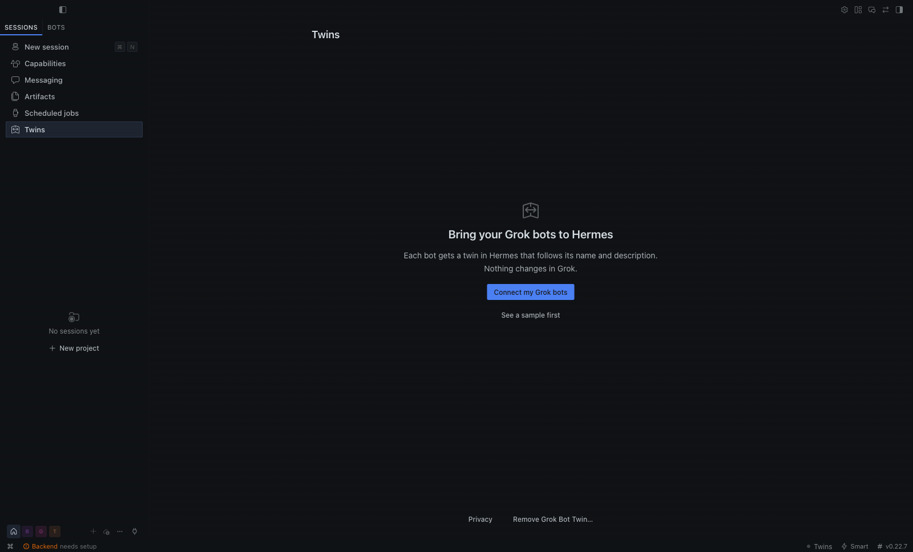 | 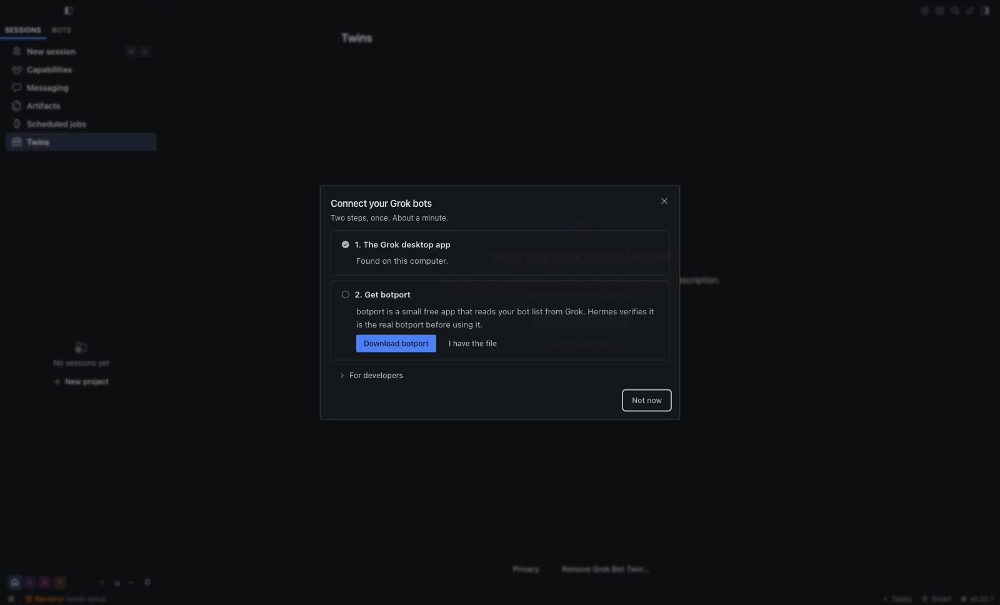 |
| Two short sentences, one button, and a sample to look at first. | Two rows that tick themselves. Nothing runs until the download is verified. |
| 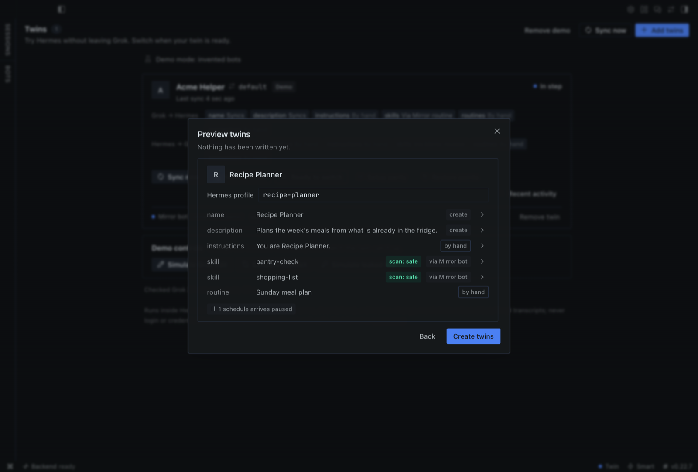 | 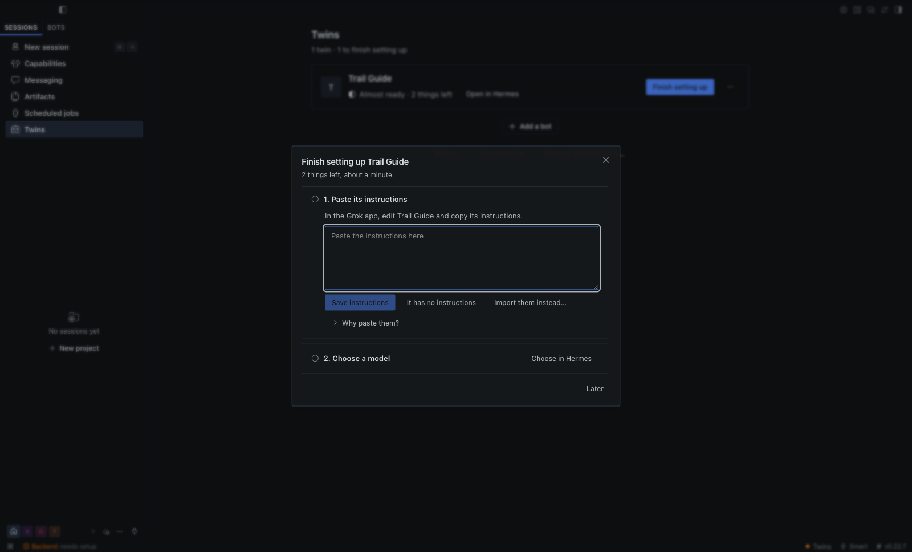 |
| Before anything is written: what copies now, and what comes later. | One twin at a time: paste its instructions, choose its model. |
| 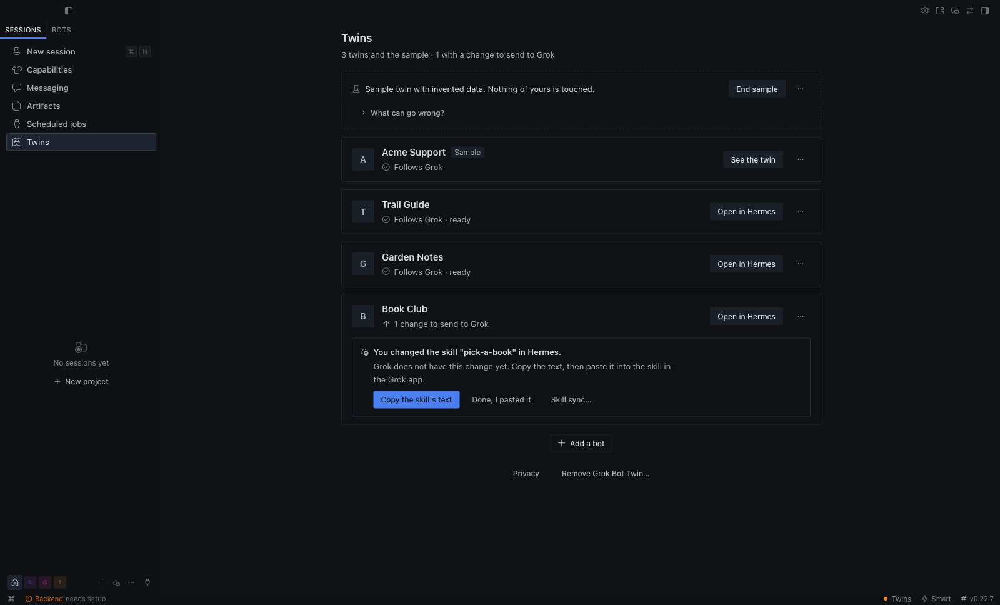 | 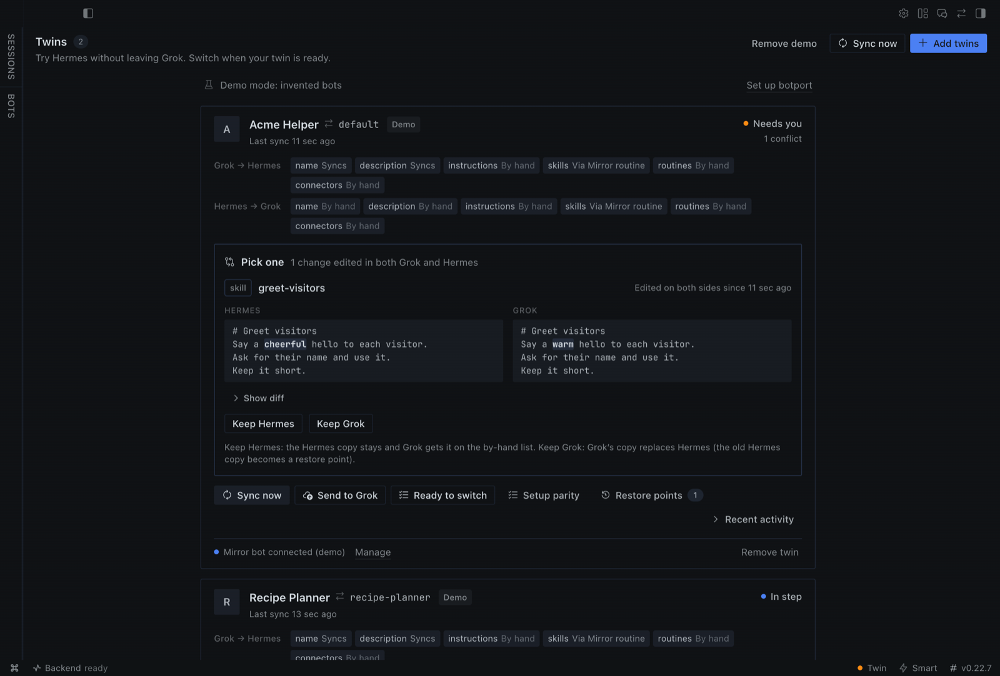 |
| One line per twin: how it is doing, and one button only when something needs you. | Changed in both places? See both versions and choose one; each choice says what happens. |
| 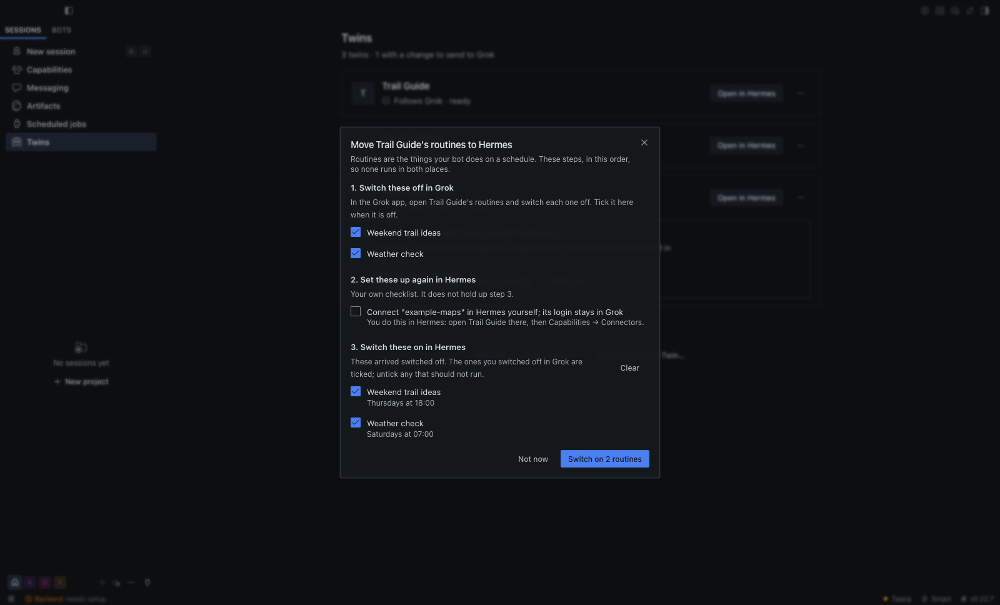 | 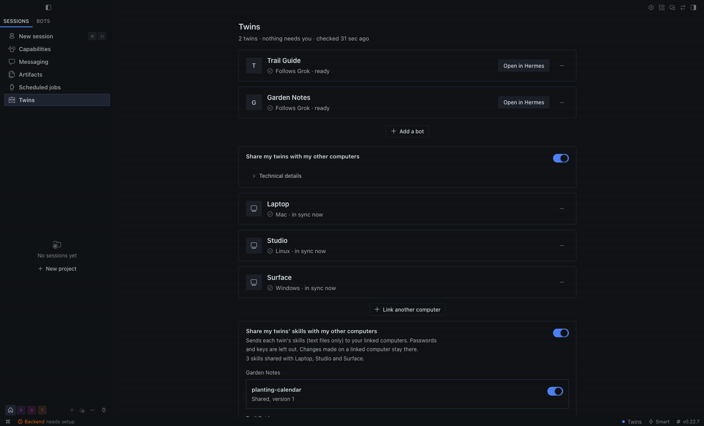 |
| A twin's routines: switch each one off in Grok, then on in Hermes, so nothing runs twice. | Sharing switched on: your other computers, each in sync, and the skills they share. |
| 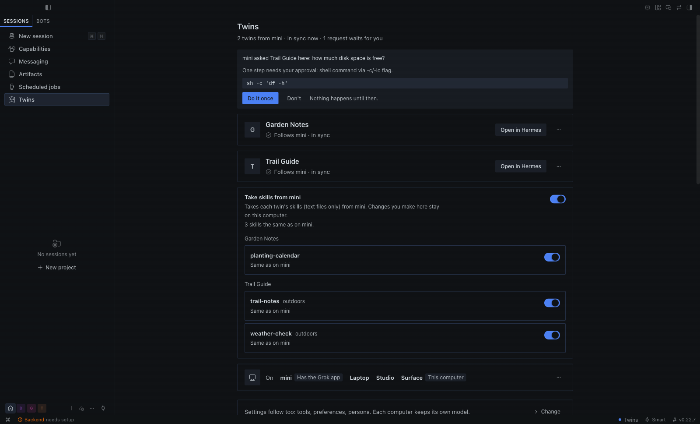 | 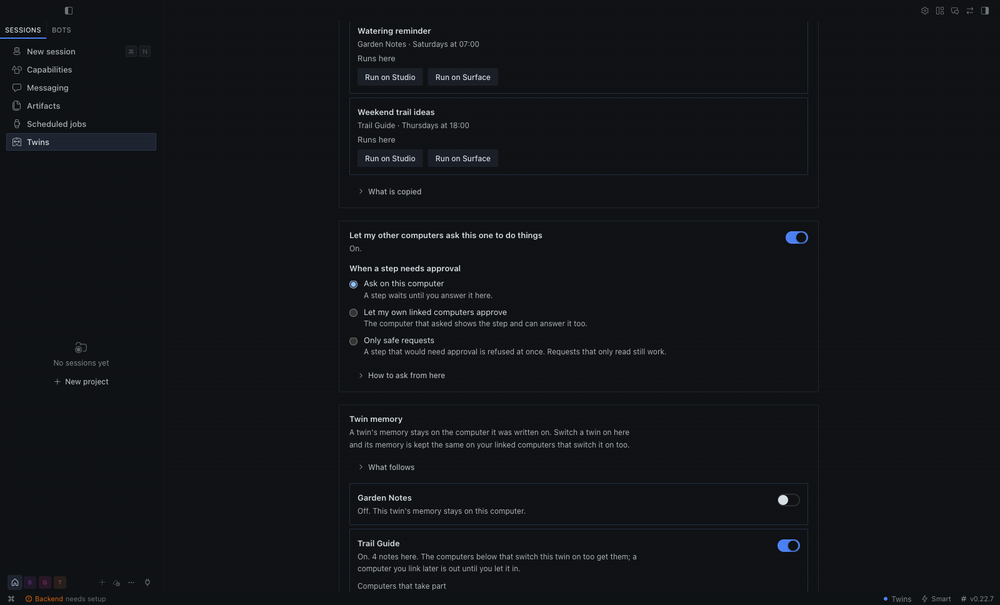 |
| On a linked computer: a request from the Mac shows the step first and waits for **Do it once** or **Don't**. | A step that needs approval waits on this computer, is also shown on the computer that asked, or is refused at once. |
| 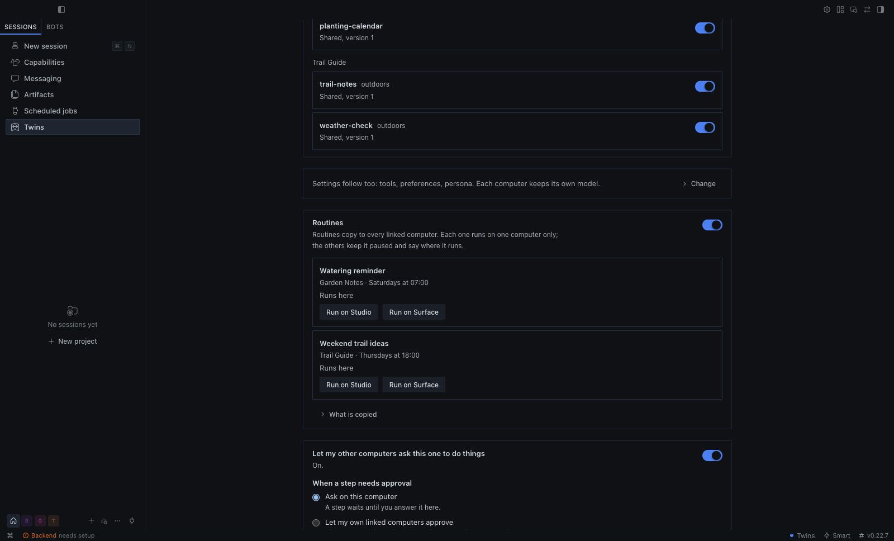 | 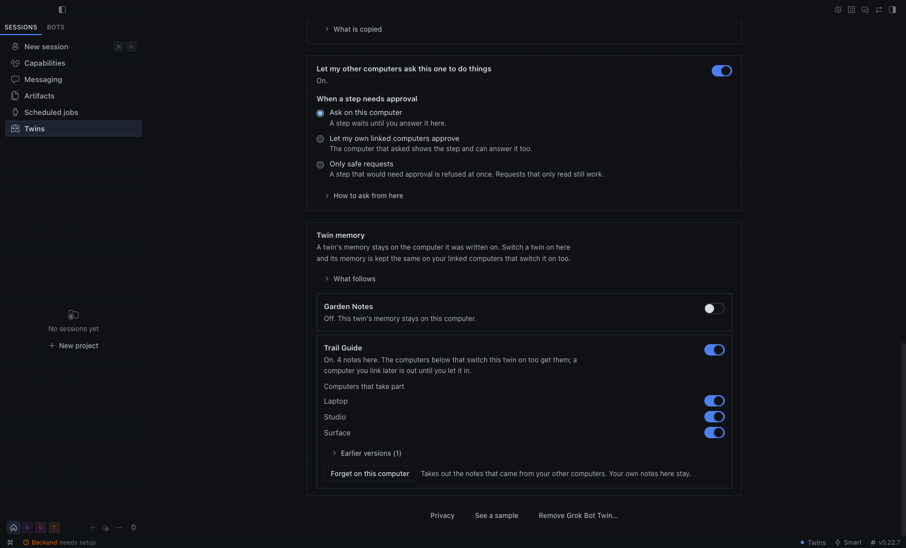 |
| Settings, skills and routines follow to your linked computers; each routine runs on one computer only. | A twin's memory, kept the same on the linked computers you choose, with earlier versions and **Forget on this computer**. |
| 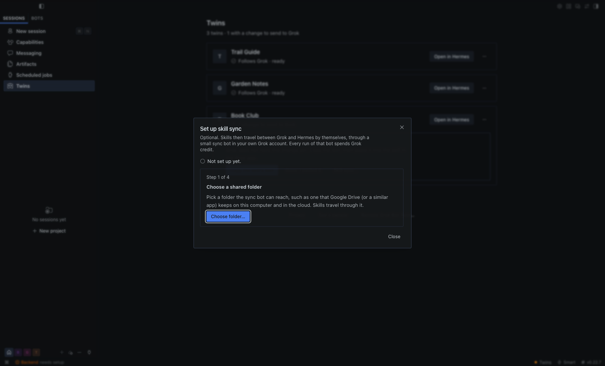 | 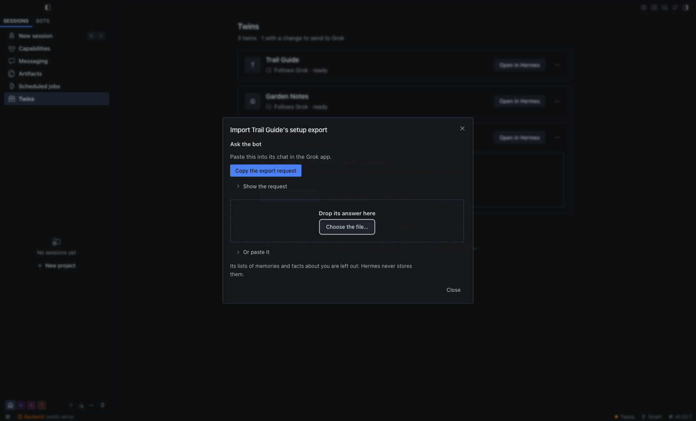 |
| Optional skill sync in four steps; it says first that its sync bot spends Grok credit. | Ask the bot in Grok for its setup export, then drop the answer here. |
| 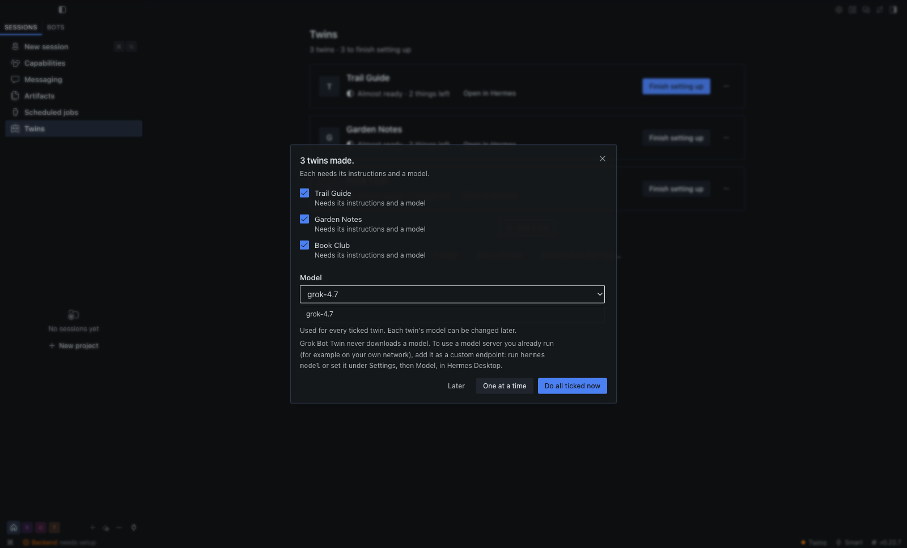 | |
| Several new twins at once: one model for all, and each one's setup export taken in as it arrives. | |

The pictures are taken in a throwaway Hermes home with invented bots only.

## Start from wherever you are

However you start, the same command does the work: `hermes twin setup`. It can be run again at any time, and a
step that is done is skipped.

| You are | Do this |
|---|---|
| In Hermes Desktop | Open **Twins** and press **Connect my Grok bots** (see [Connect your Grok bots](#connect-your-grok-bots)). |
| In a Hermes chat | Say "set up Grok Bot Twin". The plugin ships a skill (`grok-bot-twin:set-up-grok-bot-twin`) that walks you through it in the chat: it shows the plan, waits for your yes, links your other computers and offers skill sync. |
| In a coding agent (Claude Code, Cursor, Codex or any other) | Point it at this repository. [AGENTS.md](../AGENTS.md) gives it the exact steps, what it must never do, and how to check its work. |
| In a terminal | `hermes twin setup --check`, then see [One setup command](TERMINAL.md#one-setup-command). |

Whoever runs it, four things stay yours: downloading botport with your browser, bringing each twin's
instructions over, choosing a model for a twin that has none, and every sign-in. No agent is asked to type a password, a key or a twin's pass, and none makes
changes in the Grok app.

Two more ways in are designed and not built: Hermes doing the clicks in the Grok app for you while you watch
and approve each one, and a Grok bot setting itself up as the sync bot. Neither has been run on the real Grok
app; [SETUP-ORIGINS.md](SETUP-ORIGINS.md) has both designs and the test plan.

## Everyday use

Each twin is one row: the bot's name, one sentence ("Follows Grok · ready", "Almost ready · 2 things left",
"Updating…", "3 things need you", "Not following Grok right now", "Not in Grok any more", "Can't check right
now") and at most one button. When anything is waiting for you, exactly one button on the whole page is the
highlighted one, and the line under the title counts every kind of open thing ("3 twins · 1 needs your
attention · 3 to finish setting up"). Everything else is in the row's **…** menu: Check now, Details…,
Earlier versions…, Import setup export…, Skill sync…, Move routines to Hermes… (when the bot has routines) and
Stop twinning….

**Open in Hermes** starts a chat with the twin. Twins is still there when you come back: if Hermes Desktop is
pointed at the twin's own Hermes bot, the page goes back to your twins by itself.

When something needs you, the row shows the first matter as a box that says what happened and what to do, and
any others as one-line headers you can open:

- **Changed in both places.** You see both versions with the changed words marked and choose one. Keep the
  Grok version: it replaces the one in Hermes, and you can undo that under Earlier versions. Keep the Hermes
  version: Grok still has its own, and you can send this one to Grok afterwards.
- **A skill changed in Hermes.** With skill sync on: send it to Grok (a skill Grok does not have yet is
  installed there; for one it already has, paste the change into Grok yourself), or keep it in Hermes only. Without:
  **Copy the skill's text**, paste it into the skill in the Grok app, then **Done, I pasted it**.
- **A password or key was not copied.** Something in the bot's text looks like one (known key formats, private
  key blocks, long random-looking words), so that item was not copied at all. You see which item and where,
  never the value. Remove it in the Grok app; Hermes notices by itself. This check can miss things: keep
  passwords and keys out of a bot's text.
- **Can't check right now.** The reason and the one thing to do, in plain words, and **Try again**.
- **Not in Grok any more.** The twin stays as an ordinary Hermes bot. **OK, stop following**, or wait for it
  to come back.

When no twin can follow Grok, one banner says why, once, and the rows say "Not following Grok right now"; you
can still open every twin in Hermes. botport was updated: **Verify botport** fixes it in one press. botport
is gone: **Get botport again…**. The Grok desktop app is gone: nothing to press; the banner clears by itself
when Grok is back.

No pop-up repeats what the page is already showing. Elsewhere in Hermes a notice appears once, leaves by
itself, and its button opens Twins.

**Details…** is one sheet with three sections:

- **What copies over**: what copies by itself, what copies with skill sync on, what you bring over yourself,
  and what matches Grok right now ("Name, description and 2 skills match Grok."), with the reason and the
  button for each part that differs. **The whole table** opens the table from [What copies over, honestly](../README.md#what-copies-over-honestly): every item, how it gets across, and why Grok memory and the Grok model setting do not copy.
- **Earlier versions**: whenever a check (or your choice of the Grok version, or a paste) replaces something
  in the twin, the version before is kept. **Show** lets you read it and **Put back** acts at once; the notice
  that follows offers **Undo**. Putting one back changes only that item in Hermes. A twin that has not changed
  yet lists none.
- **Recent activity**: what changed lately and where. Times and kinds only, never what was said.

**Move routines to Hermes** (routines are the things your bot does on a schedule): switch the routines off in
Grok and tick them. Where the twin holds switched-off copies of them (the sample does), the last step,
switching those copies on in Hermes, opens when they are ticked, with the same routines ticked already, so
nothing runs twice. A twin made from the Grok app's files holds no copies, because Grok keeps a routine's
schedule to itself: the sheet says so and lists each routine for you to make again in Hermes. Only two things
hold this up: a choice between two versions that is still open, and a twin that cannot be checked. Afterwards the row says "Follows Grok · 2
routines run in Hermes" and offers **Pause routines**, which switches them off in Hermes again; the menu item
becomes **Routines in Hermes…**.

**In chats**: in a twin's Hermes bot the model gets a short, data-only note each turn ("your Grok twin", an
internal id such as `t-1a2b3c4d5e6f7a8b` and whether it is up to date). The `twin_status` and `twin_recent`
tools use the same label and id: by default no bot, routine, skill or connection names reach the model (its
to-do list says "Turn off 2 routines in Grok when you move to Hermes (names on the Twins page)"). Turn on
"Let the model see names" to let the tools name them, reduced to plain characters; the per-turn note never
carries names. The sample twin stays out of your chats unless you name a Hermes profile for it in the
settings, and then the note says "This is a sample twin with invented data."

### Example: the agent answers from `twin_status`

An example chat about the sample twin (the reply is the model's wording; the facts and counts come from the
`twin_status` tool result, with names off):

> **You:** What do I still need to set up in Grok?
>
> **Assistant** (called `twin_status`): This is the built-in sample twin with invented data. Your Grok twin is
> up to date, with nothing changed in both places. In Grok: turn off 2 routines when you move to Hermes, so
> nothing runs twice (their names are on the Twins page), and if you change the name, description or
> instructions here in Hermes, make the same change in Grok yourself. In Hermes: turn on the 2 routines when
> you move and set up 1 connection yourself. Skills copy when skill sync is on.

### Import setup export

A Grok bot can write down its own setup, and its twin can take it in. In a twin's "…" menu choose **Import
setup export…** (the terminal has `hermes twin import`):

(For several new twins at once, the sheet after **Twin N bots** does this for all of them: see [Connect your Grok bots](#connect-your-grok-bots). Each file is then imported as it arrives, without the preview below; what it does is the same.)

1. Press **Copy the export request** and paste the text into the bot's own chat in the Grok app. It asks for
   the bot's instructions, its routines and the names of its connectors, and for nothing the bot remembers
   about you. The bot answers with one file.
2. Drop that file on the sheet (or press **Choose the file…**, or paste the answer). The sheet shows what an
   import would do; nothing is changed until you press **Import**. Open **Show the text** and read it first:
   it holds the instructions and every routine's prompt whole, exactly as an import would save them.

What an import does:

- **Instructions** are saved as the twin's instructions, the same way a paste is. Every line a password or key
  touches is left out (a label on one line and its value on the next are both left out) and the sheet names
  the line numbers. Characters nobody can see are taken out. The version before is kept under Earlier
  versions. Instructions over 200 kB are not copied.
- **Routines** arrive switched off: each one with a five-field schedule becomes a Hermes routine that does not
  run. Turning them on is still **Move routines to Hermes**, after you switched the Grok ones off, so nothing
  runs twice. A routine that starts on an event, whose prompt is longer than 16 kB, or whose name or prompt
  looks like it holds a password or key, is not made; the sheet lists it for you to add yourself. A routine
  whose name is already in the twin's Hermes bot is left alone (by name; the two are not compared).
- **Connectors** become a list, "Set up on this computer", of names only. No address and no login is copied.

The file's lists of memories and of facts about you are left out: Hermes never stores them. The file itself
is not kept either: its text is read for the preview and once more for the import. What an import writes is
the three things above and four small notes of its own: the ids of the routines it made, that the
instructions came from an export, for each routine its name with a short digest (so its Hermes copy does not
ask to be sent back to Grok), and an event with counts. Skills in the file are counted and left alone (skills
travel by skill sync, or you copy them yourself). Nothing is sent to Grok. The file is the same
`grok-bot-export` document that botport's `--from-export` and Hermes' own Grok importer read, so an export you
already have works too.

What this cannot do for you: the bot wrote the file. Whatever it put into its instructions, a routine or a
connector's name is taken as that, also when it is something the bot remembers about you; Hermes can only
leave out the two lists that are named as memories. The password-and-key check is a check, not a guarantee:
it misses short passwords and addresses with a login in them. So read the text before you import. While a
routine is being added, its name and prompt are arguments of a Hermes command for a few seconds, which other
users of this computer could see. **Stop twinning** later forgets the list of connectors; the imported
instructions and the switched-off routines stay in the Hermes bot, which is yours.

## What syncs, and Hermes → Grok

Per twin, **What syncs** in its Details (and
`hermes twin syncs TWIN`) shows each item with the way it goes, when it last synced, and what this version cannot
do yet; a row that needs the Mirror or is not in this version yet says so and cannot be switched on.
Hermes → Grok (name, description, instructions and routines made in Grok by the Mirror bot) is off for every twin
until you allow that twin (`hermes twin to-grok TWIN allow`, or the twin's **Hermes → Grok…** on the Twins page),
and nothing is sent until you look at the preview and apply exactly that preview. The Auto-Review rule it shows for
Grok names the bot by its id and covers only edits of that bot's own name, description, instructions and existing
routines, never a new routine; stopping (`hermes twin to-grok TWIN disallow`) names that exact rule for you to delete
in Grok.

Why so much is yours to bring over: from the Grok desktop app's local files, botport opens only the bot list
(id, name, description) and the selected bots' transcript files, read only for routine-change events. Those
files hold no instructions, skills, schedules or connections, and botport takes nothing else out of them, so
the plugin does not pretend otherwise.

## Skill sync (optional)

Skills can travel between Grok and Hermes through a small sync bot in your own
Grok account and a shared folder that sync bot can reach (for example one that Google Drive keeps on both
sides). **Every run of the sync bot's routine spends Grok credit, also when nothing changed**: once an hour is plenty.
Hermes never touches the Grok app; the **Set up skill sync** sheet does everything else and shows one step at a
time, each with its buttons:

1. **Choose a shared folder.**
2. **Give the sync bot its instructions.** You make a new bot in Grok; **Copy instructions** has the text.
3. **Send it the set-up folder.** Hermes made one folder with all the sync bot needs: its guide, a small
   script, botport for its box with checksums, and the twin's pass as a file. You attach every file in it to
   one message (**Copy the message** has the words) and never paste what is in a file. botport for the box
   is a second download from the same release page; the sheet has the link, finds the file in your Downloads
   folder and checks it against the plugin's list of release files before it goes into the folder.
4. **Give it a routine, then check.** **Copy routine prompt** has the text; **Check** shows when the sync bot
   last ran.

| What the sheet does for you | How |
|---|---|
| A new skill you send from Hermes is installed in Grok from the first run | the script lets botport install each one, after botport checked it against the twin's pass |
| A later twin needs no chat | **Add NAME to skill sync**: Hermes puts a signed list and that twin's pass (a file) in the shared folder; the sync bot takes them on its next run |
| You can see that it works | "Skill sync last ran 12 min ago", read from one small file the script writes on every run |
| The sync bot's botport is checked | if it is not the release this computer runs, the sheet says so and offers **Send the set-up folder again…** |

Turning skill sync off asks first: skills go back to copy-yourself, the sync bot's list no longer names the
twin, and the pass is replaced, so the sync bot must be set up again to turn it back on. In the terminal:
`hermes twin skill-sync --folder DIR` prints the same steps with the files to use, and
`hermes twin skill-sync --status` says when the sync bot last ran.

## Memory facts with Grok (0.3.0)

Off for every twin. Switch it on in the twin's **What syncs** panel (row "Memory facts"; the terminal has the
same panel). Then the facts the Grok bot remembers and the notes in the twin's
`MEMORY.md` and `USER.md` are kept the same, one fact per note, each ending with where it came from and when:
`Prefers short answers. (fact g3a91c0e, from Grok, 2000-01-02)`. Leave the part in brackets as it is: it is how
the fact is matched with Grok. Deleting the whole line removes the fact on both sides.

**Both ways.** A fact added, changed or removed on one side is added, changed or removed on the other. If it was
changed on both sides, or changed on one and removed on the other, both stay as they are and the panel asks which
to keep (`hermes twin facts "Test Scout" keep <id> hermes|grok`). Before a memory file is changed, the file as it
was is kept (`hermes twin facts "Test Scout" restore <point>`).

**What never crosses.** The same check as memory between your computers: a fact that looks like it holds a
password, key, code or card number, or reads like an instruction, stays where it was written; the panel counts
them and never shows them. Both directions need the Mirror: until it is set up, the row says so and no fact
moves.

## A twin's whole conversations (archive and search)

Off until you switch it on for a twin. Then the plugin keeps that twin's conversations on this computer, both sides:
the Grok bot's (from a Grok export with conversations you hand over, or that the Mirror reads once it is set up) and
the twin's own Hermes chats. They stay here, encrypted, and the twin can search them with its
`twin_transcripts_search` tool ("what did we decide about the demo last week?"). Another twin cannot.

```
hermes twin transcripts on "Test Scout"                  # start keeping; `off` stops (what was kept stays)
hermes twin transcripts add-grok "Test Scout" --file export.json
hermes twin transcripts refresh "Test Scout"             # add the twin's Hermes chats so far (run again for newer ones)
hermes twin transcripts search "Test Scout" -q "demo plan"
hermes twin transcripts export "Test Scout" --file my-chats.json   # your own JSON copy, readable by you only
hermes twin transcripts to-hermes "Test Scout"           # Grok conversations become Hermes chats ("From Grok: ...")
hermes twin transcripts forget "Test Scout" --yes        # delete everything kept for that twin
```

What the Hermes twin said is never given to Grok unless you also switch that on (`to-grok-on`; off by default, off
again whenever the archive goes off). The What syncs panel's "Conversations (full)" row is the same switch. The
encryption protects copies of the archive (a backup, a synced folder); someone who can already read your files can
read the key too. Details: [DISCLOSURE.md](DISCLOSURE.md).

## How fast is it?

- **Name and description, Grok → Hermes: seconds.** While Hermes is running (a chat or the Twins page was opened
  since it started), the plugin is woken the moment the Grok app saves its bot list, and copies the change.
  From the saved file to the updated twin took about 0.6 s in our test runs with the real botport (slowest:
  0.8 s), on the slow (efficiency) processor cores. The Grok app itself saves a rename about 1 to 2 seconds after you press Return,
  and a description change after the bot's own reply (about 4 to 9 seconds), so expect about 2 to 3 seconds for
  a rename and under 10 for a description. The Twins page then shows it at its next look (every 5 s).
- **If the bot list is rewritten constantly**, wake-ups are spread out (2, 4, 8 ... at most 30 s apart), so
  the worst case stays under the timed check.
- **Everything else** (a skill you changed in Hermes, routines, a twin's Hermes files) is found by the timed
  check, every 60 s by default, or at once with **Check now** / `hermes twin check`.
- **Your other computers:** a linked computer keeps one request open with the computer that shares; it is
  answered the moment a twin's name or description changes there, so the copy follows 0.3 to 1.4 s later
  (measured between four computers over Tailscale; the table under "What you get, and how fast" has the
  rest). An idle link costs one small request a minute.
- **Hermes closed:** nothing runs. The twin catches up at the first check after Hermes starts.
- **Instructions never copy from Grok by themselves.** You paste or import them once; between your own computers
  they then follow as a setting.

## Settings

Desktop, Settings, Plugins, Grok Bot Twin (or `plugins.entries.grok-bot-twin.settings` in `config.yaml`):

| Setting | Key | Default | What it does |
|---|---|---|---|
| How often to check Grok (seconds) | `sync_interval_seconds` | 60 (min 5) | the timed check: how often Hermes looks for changes to your Grok bots and their twins (file dates and sizes only). A changed name or description does not wait for it (next row) |
| Notice name and description changes right away | `watch_grok_changes` | `true` | Hermes is woken when the Grok app saves its bot list, and runs the same check at once. It looks at file names, dates and sizes only, never content. Off: such a change waits for the timed check |
| Bots to list | `bots` | `[]` | only list Grok bots whose names match (for example `Acme*`); nothing is twinned until you pick it |
| Let chats know this is a twin | `inject_context` | `true` | the short per-turn note in chats with a twin's Hermes bot |
| Let the model see names | `share_names_with_model` | `false` | let the `twin_status` / `twin_recent` tool results name the bot, its routines, skills and connections (plain characters only); off, they say "your Grok twin" and an internal id. Never affects the per-turn note |
| Allow an activity digest to Grok | `digest_to_grok` | `false` | allows a per-twin activity digest (counts and times) that goes along when you send skill changes to Grok; each twin still starts off |
| Include short titles in the digest | `digest_titles` | `false` | separate opt-in for short, masked titles in that digest |
| Where botport is (advanced) | `botport_path` | `""` | full path of botport, if you keep it somewhere special |
| botport release to accept (advanced) | `botport_release_tag` | `""` (uses v0.2.1) | the release botport is verified against; empty means the release this plugin version expects, v0.2.1 |
| Grok app folder (advanced) | `grok_app_dir` | `""` | only if the Grok app keeps its data somewhere unusual |
| Grok account (only if you use several) | `grok_account` | `""` | only when the Grok app holds more than one account: the 8-character label botport lists for yours (a label, never the account) |
| This computer's name | `machine_name` | `""` (the computer's own name) | how this computer is called on your other computers and in each twin's note about where its copies are |
| Port for sharing with your other computers (advanced) | `share_port` | 18777 | the port the computer with the Grok app listens on while sharing is on; set the same number on every computer if you change it |
| Address to share on (advanced) | `share_address` | `""` | empty: this computer's Tailscale address, else its home-network address. Only one of its own private addresses is accepted |
| Show the sample in this Hermes profile (advanced) | `demo_profile` | `""` | empty: the sample stays out of all your chats; a profile name lets that profile's chats see the sample |

## Uninstall

Three ways out, each with one confirmation that says what stays and what is removed.

**Stop twinning one bot** (the row's **…** menu, or `hermes twin remove`):

- Stays: your bot in Grok, unchanged. Its Hermes bot and all its chats; you find it among your profiles in
  Hermes, and the confirmation that follows has an **Open in Hermes** button. Routines you switched on in
  Hermes keep running there.
- Removed: following Grok, and the earlier versions kept for undo; on the Twins page also what the page
  remembered about it (boxes you ticked, the skill sync guide).
- If skill sync was on for it: in Grok, tell the sync bot to forget this bot; Hermes cannot reach it.
- You can twin it again later.

**End the sample** (**End sample** on its banner or in its **…** menu, or `hermes twin demo remove`): the
sample is removed. Nothing of yours changes.

**Remove Grok Bot Twin** (**Remove Grok Bot Twin…** at the bottom of the Twins page, or
`hermes twin uninstall`):

- Stays: your Grok bots. Your Hermes bots and their chats. Routines you switched on in Hermes keep running
  there.
- Removed: only what exists at that moment (every twin with its earlier versions, the sample, Hermes' copy of
  botport; your download stays in Downloads). On a linked computer also the Hermes bots listed under **Hermes
  bots kept for 30 days** (twins that were removed or unlinked in the last 30 days, with their chats): press **Keep this
  bot** first on any you want to keep. Pressed on the Twins page, it also clears the page's own notes in
  Hermes Desktop's storage (boxes you ticked, the skill sync guide, the profile your twins are looked after
  in); `hermes twin uninstall` runs outside Hermes Desktop and cannot reach those.
- If skill sync was on: in Grok, delete the sync bot's routine yourself; Hermes cannot reach it.
- If you share twins with your other computers: sharing stops; they keep their twins and say that Grok Bot
  Twin was removed on the Mac. On a linked computer: the link ends and its twins stay as ordinary Hermes
  bots; following while Hermes is closed, if you turned it on, is stopped and its file deleted (on Windows,
  its scheduled task).
- This cannot be undone. You can connect again later: a bot you twin again then gets the Hermes bot it had
  before, with its chats, when that bot is still there and still carries the bot's name from Grok.
- The page then shows one last screen, "Everything is removed", with the one step that is left and its
  button: **Open Plugins**, where you switch **Grok Bot Twin** off (in the terminal:
  `hermes plugins remove grok-bot-twin`). Removing the plugin alone leaves its data folder
  (`plugin-data/grok-bot-twin/`) on disk; **Remove Grok Bot Twin** is what empties it. The same goes for
  following while Hermes is closed, if you turned it on: **Remove Grok Bot Twin** (or
  `hermes twin background off`) deletes its one file; after removing the plugin alone it notices that the
  plugin is gone and stays stopped, and its file is left for you to delete.

## Known limitations

- Under `plugins.isolation: host`, Hermes skips plugin CLI commands, so `hermes twin` is unavailable there; `/twin`
  and the Twins page still work.
- Skill sync's box half (the script the sync bot runs) is tested here against botport in a pretend box, with
  invented bots; the plugin cannot test it inside your Grok account. The first run there is yours to watch:
  **Check** shows whether the sync bot ran. Adding a later twin without a chat, or sending a replaced pass, needs
  `python3` in the sync bot's box (to check the signed list); without it the script says so in its heartbeat,
  and the sheet offers **Send the set-up folder again…** (`hermes twin skill-sync --again`), which does it by
  chat.
- botport has its own, stricter check for passwords and keys. Before it changes anything in a twin's Hermes bot
  it keeps a copy of that bot's files, and it will not do that while one of them holds a line it takes for a
  password or key, including a line of pasted instructions you said was not one. Updates from Grok then stop
  for that twin. The twin's row says so, names the line, and the update arrives by itself once the line is gone.
